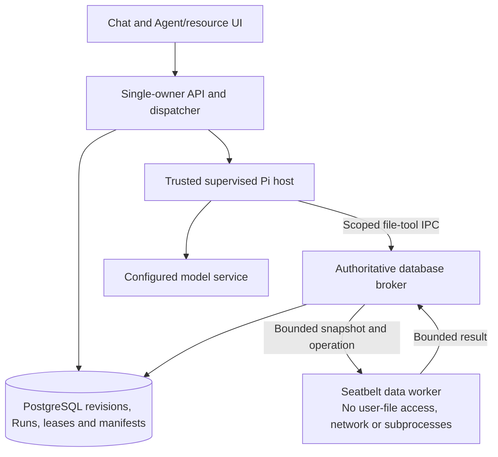
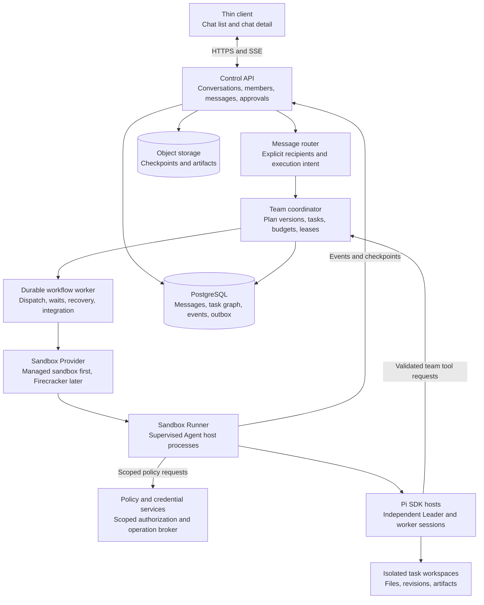

# NexRun Architecture

Status: Broader target architecture with an implemented local Sprint 1/2 slice; final live Pi acceptance remains unverified

Updated: 2026-11-05

Language: English

[Simplified Chinese version](architecture.zh-CN.md)

NexRun's target is a chat-first cloud application for operating coding Agents. The implemented product is local and single-owner, with Pi as its primary and only deeply integrated Agent runtime. Users start from a chat list and chat detail, with Agent/resource management available separately. Group chats and bounded Agent Team execution belong to later releases.

The broader target combines thin clients, a persistent control plane, and disposable cloud sandboxes. Each Pi runtime keeps its native reasoning loop and context inside its execution environment. NexRun owns conversation access, message routing, team coordination, durable tasks, authorization, event history, and recovery. In that target, a team Leader is a sandboxed Pi Agent; the control-plane coordinator is a deterministic service, not another unrestricted reasoning loop. The current local data-worker boundary is described separately below and does not implement the cloud/team topology.

Commercial dependency admission and language conventions are governed by [AGENTS.md](../AGENTS.md). All package versions, transitive dependencies, images, extensions, and service terms must pass that policy before adoption.

## Current delivery scope

[Sprint 1](sprints/sprint1.md) supplies React/shadcn UI, the Node.js service, PostgreSQL direct-chat persistence, streaming, cancellation and independent native Pi sessions alongside a deterministic mock. Its initial Pi configuration is tool-disabled.

[Sprint 2](sprints/sprint2.md) implements versioned profiles, conversation-local Agent identities, context epochs, persistent virtual text Workspaces, restricted file tools, manual knowledge/declarative skill revisions and source manifests. The `/agents-workspaces` UI provides profile/resource management, text-file editing/diffs and explicit chat bindings. Pure text chats retain an empty tool list; explicit Workspace Runs may use only authorized `file.list`, `file.read`, `file.search` and `file.write` operations. Scripts, repository instructions, extensions and automatic resource discovery remain disabled.

Local verification on 2026-11-05 passed typecheck, lint, build, license checks, 113 Node tests and 22 browser scenarios. Real local worker-enforcement checks are distinct from deterministic model/SDK fixtures. The environment's live Pi/OpenAI authentication still fails, so successful live model-driven workspace editing and final Sprint 2 acceptance remain unverified.

The group/team, repository execution and cloud sandbox sections describe the broader target, not current features. No Team scheduler, general shell, VM management, Temporal, Valkey or object storage is required by the implemented slice. Full public multi-tenant isolation is not claimed.

### Implemented Sprint 2 execution boundary

Workspace files are bounded, immutable PostgreSQL text snapshots with explicit revisions, operation IDs, exclusive Run leases and fencing tokens. They are not OS-mounted working directories or Git repositories. Checkpoint manifests pair a Workspace revision with a sealed native-session copy and the corresponding context/profile/resource/runtime versions. Storage and native state survive individual worker processes; incompatible or uncertain recovery cannot silently reuse context or repeat an operation.

The reviewed local execution provider invokes the installed Apple `sandbox-exec` with a deny-by-default Seatbelt policy. Only the hash-pinned Node 22.20.0 arm64 runtime and reviewed Apple executable are admitted. Each platform-owned data worker accepts a bounded text snapshot over stdin, performs in-memory file operations and returns bounded results. It cannot read user host-file contents, write host files, connect to a network or spawn subprocesses. It does not evaluate imported text. The trusted Pi/model host and database broker remain outside this worker; the broker independently checks ownership, operation identity, revision and active execution authority before publishing changes.

Readiness verifies binary/policy identities and actual restrictions and fails closed on unsupported hosts. The five-second worker deadline, bounded IPC and 64 MiB V8 heap are not a general OS-level RSS/CPU quota. System library/share reads and directory metadata remain permitted. The deprecated Apple interface is admitted only for the reviewed local macOS use; there is no Linux, VM, shell or hostile multi-tenant execution guarantee and no new image or downloaded runtime. See the [native runtime review](dependencies/native-runtime.md) and [exact inventory](dependencies/native-runtime.json).



## Goals and scope

The initial release provides a reliable English and Simplified Chinese direct-chat product backed by Pi. Later group/team releases add membership, explicit Agent addressing, and a predefined Leader, Builder, and Reviewer team. In that later model, a single user can create a group containing several Agents, and other authorized humans can join it.

A **group** is a shared Conversation with members and an access policy. An **Agent Team** is a versioned role and delegation configuration. A **team Run** is one execution of that configuration for a user goal. These are distinct objects: creating a group neither starts a team nor grants it credentials. Sidebar folders and labels, if added, are presentation features rather than security groups.

The current local release excludes Agent Teams, group chats, multiple CLI integrations, a full IDE, arbitrary executable tools, free-form Agent debate, recursive delegation, desktop streaming, automatic skill installation, and model fine-tuning. Sprint 2 adds only the restricted text-file operations described above. Future Agent Adapters remain an extension boundary, not a delivery requirement for this slice.

## System boundaries (target)



### Thin client

The browser renders chat history, group membership, Agent identities, execution cards, approvals, and expandable details. Server state is authoritative; a local optimistic message is marked pending until durable acceptance. Closing the browser does not stop an accepted Run.

Use SSE for authorized conversation updates. Terminal WebSockets, diffs, files, previews, and artifacts are optional detail surfaces opened from the chat, not permanent top-level panels. The browser holds no infrastructure administration credentials or unrestricted database access.

### Control plane

Use a modular monolith with API and workflow worker processes. Its conversation module enforces membership, its message router resolves recipients, and its team coordinator validates and persists proposed plans. The coordinator schedules through one durable workflow system; it does not trust an Agent to mutate task tables directly.

The Leader proposes a plan through controlled tools. Authorization, dependency validation, budget reservation, execution state, and cancellation belong to the platform. The Leader cannot approve its own requests or expand the initiating user's authority.

### Execution plane

A Runner supervises a dedicated Node.js Agent host process for each active Pi session inside a sandbox. Use the Pi SDK in those hosts to configure resources and tools. Do not import repository-controlled extensions into the API process. Independent processes help lifecycle isolation; separate sandboxes and filesystem/network controls enforce the actual tenant and workspace boundaries.

The Runner can report scoped execution events and issue authorized team-tool requests. These requests remain untrusted proposals and must be validated against the current Run, attempt, role, and plan version.

## Product model and workspace ownership

| Entity | Responsibility |
| --- | --- |
| Organization | Tenant boundary, membership, policies, and quotas |
| Project | Optional repository connection, environment defaults, and project access policy |
| Conversation | A direct or group chat; communication history and membership boundary |
| ConversationMember | A human or conversation-local Agent participant with stable ID and scoped permissions |
| Message | A conversation entry with author, explicit recipients, reply target, and execution intent |
| AgentProfile | A reusable recipe for Pi model settings, role prompt, tool policy, and resources |
| AgentInstance | A conversation-local Agent identity, instantiated from a profile |
| AgentTeamDefinition | A versioned template of roles, allowed delegation, and limits |
| TeamBinding | An instantiated team assigned to a Conversation, with concrete AgentInstances |
| Run | A durable user goal with mode `single` or `team`; a team Run snapshots its TeamBinding |
| Task | A versioned work, coordination, or integration unit within a Run, with dependencies, executor, and result contract |
| AgentSession | Native Pi conversation/context for one AgentInstance and its permitted execution scope |
| ExecutionAttempt | One leased dispatch of a Task to a Runner, with fencing token and native turn mapping |
| Workspace | Durable file state independent of the live runtime; Sprint 2 uses PostgreSQL text snapshots, while later repository execution adds working copies and environment specifications |
| KnowledgeItem | Versioned fact, preference or document with provenance, access scope and withdrawal state |
| SkillDefinition | Versioned procedural instructions and reference material with declared tool requirements |
| ContextManifest | Authorized input references/versions, selection decisions and context-budget metadata for a Run |
| Approval | Scoped human authorization for an exact operation |
| Checkpoint and Artifact | Recoverable state and retained, versioned outputs |

A Conversation is not a Pi session. One group may contain several independent AgentSessions, and a native Pi transcript is not the shared chat log. A Run is a platform user goal, not a synonym for a single native Agent turn. `TeamRun` denotes `Run.mode = team`; it does not introduce a second competing execution record.

Direct chats can reuse an AgentSession across serial Runs when authorization, Agent identity, Workspace, and context scope remain unchanged. A team Leader uses a Run-scoped session; each delegated worker Task starts with a separate session and explicit task packet. An attempt can resume that Task's native session only after reconciliation. Never share native sessions across Conversations or concurrently prompt the same session.

An AgentProfile is a recipe, not a global context or credential container. Instantiating the same profile in two groups creates independent AgentInstances. Snapshot the team definition, profiles, repository base revision, and policy version for each Run; editing a template changes future Runs unless an explicit revision is accepted.

Projects are optional when starting a discussion. Execution that needs source files must bind to a Project and authorized Workspace. A group may discuss several projects, but the first repository-enabled release binds each Run to at most one repository; it does not silently combine filesystem or credential scopes.

Workspace mutation requires an exclusive lease, including terminal and auxiliary-tool writes when those tools are introduced. Sprint 2 conservatively leases the Workspace for an entire Run, including read-only Runs, while immutable revision views remain available. Future concurrent writing Tasks receive independent working copies and normally separate sandboxes. Git worktrees share repository metadata and are not a tenant boundary. Future repository checkpoints include relevant uncommitted and untracked files, not just a repository URL and branch; current text snapshots already preserve their full declared contents.

### Agent resources and context management

Capabilities comprise Tools and Skills. A Tool exposes an operation; a Skill describes a workflow, constraints and supporting resources that may use several Tools. A Skill does not grant execution authority. Sprint 2 limits Skills to reviewed declarative content and explicitly allowed file tools; executable scripts, extensions and automatic discovery remain deferred.

Knowledge is a separately scoped resource that an Agent can access, rather than an inseparable part of its identity. Keep project facts, user preferences and reference documents versioned and attributable. Chat history records statements, including hypotheses and outdated information; it is not automatically a fact store. System/role instructions define behavior, while retrieved documents, chat content and tool results retain their status as data.

Context management selects authorized rules, task material, resource revisions and relevant files while accounting for native history and tool results. Sprint 2 records source revisions and uses conservative byte accounting with an output reserve; it rejects oversized context instead of claiming exact token accounting or automatic compaction. Limiting only newly injected text does not bound the full model input. Native continuation remains Adapter-owned; do not reconstruct it by replaying the shared timeline.

An AgentInstance may work in different Workspaces through explicit bindings, and different chats may use a Workspace serially without sharing native Sessions. Scope changes, revoked resources and externally changed file revisions require invalidating affected context. Sprint 2 uses a new context epoch and Session, rebuilt only from still-authorized sources; old transcripts and derived summaries cannot be carried over indiscriminately.

Workspace storage, native Session state and live runtime processes have separate lifecycles. Sprint 2 passes virtual snapshots through a broker; later runtimes may attach filesystem working copies. A Workspace is not the VM itself. Target Team collaboration is defined by tasks, authorized resources and versioned results, without requiring members to share one VM. Isolation and deployment choices remain separate from Team identity.

## Chat list and chat detail

The first client has two primary screens. On desktop they can appear as adjacent panes; on mobile they become list and detail routes.

| Surface | Contents |
| --- | --- |
| Chat list | Direct/group icon, title, members or team badge, last visible message, unread count, and active/waiting/failed Run indicator |
| Chat header | Conversation name, member management, bound team, current Run, optional project/branch, and scoped controls |
| Timeline | Human and Agent messages, a team plan card, Task status cards, approval/input cards, final summaries, and artifact references |
| Composer | Message, reply/recipient selector, stable-ID mentions, attachments, and explicit execution action |
| Expandable detail | Task graph, individual activity, Diff, files, terminal, usage, and application preview when needed |

Keep the main timeline readable: one user goal creates one team execution card, with worker activity nested under it. Attribute visible results to the actual Agent role. The Leader normally posts the consolidated reply; worker results can be expanded without flooding the group with every tool delta. Do not expose hidden model reasoning as a team transcript.

Store each human member's last-read conversation sequence on the server. Unread state and notifications count visible events, not every internal tool event. Missing usage data is unavailable, not zero.

The main flow is: create a direct chat or group, add Agent members or bind a team, select a repository when needed, send an addressed request, follow the execution card, approve authorized actions, and review the integrated result. Creating a group or adding a team does not allocate a permanently running VM.

## Groups and message routing

### Membership and authority

A group can contain one or more humans and multiple AgentInstances from the same tenant. Conversation membership grants access to its shared messages, not automatic access to every project or secret. When group support ships, new human members receive the shared history; the invitation flow must make that disclosure clear. Private direct-chat history and personal Agent memory are never imported automatically.

| Permission | Default authority |
| --- | --- |
| Read/post shared messages | Active authorized human members |
| Add/remove members or bind/edit a team | Conversation owner or an explicitly authorized administrator |
| Start/steer a Run or revise its plan | Authorized operator with access to the selected project and credentials |
| Cancel a Task or team Run | Run initiator or authorized operator/administrator |
| Approve sensitive operations | A currently authorized human approver for that resource |
| Propose work or publish a scoped result | Assigned Agent role through validated platform tools |

Membership roles and project roles must both permit the action. Each Run records the initiating human, authorization scope, credential source, and cost owner. Agents cannot inherit the union of all group members' privileges, use personal keys merely because their owner joined, or approve on behalf of a human.

On member removal or permission reduction, terminate that member's live subscriptions, terminal access, and short-lived links where revocation is supported. Pause Runs whose authority was revoked, invalidate affected approvals, and reauthorize before further dispatch. Rebuild affected Agent context under a new context epoch instead of assuming that deleting a chat message erases native model history or an already completed external effect.

### Deterministic recipient routing

Persist the Message first. The client sends resolved participant/team IDs alongside display mentions; the server verifies those references and records the final routing decision. Resolve handles only inside the current Conversation. Reply recipients are displayed before submission, not inferred invisibly from ambiguous text.

| Input | Default routing |
| --- | --- |
| Direct-chat message | Address the chat's Agent; queue or explicitly steer if busy |
| Ordinary group message without an execution recipient | Save as shared conversation; no model invocation |
| Explicit `@agent` or selected reply recipient | Address that Agent only, within its configured authority |
| Explicit `@team` or Run Team action | Create a team Run and activate its Leader |
| Several Agent mentions | Route only to the explicitly selected Agent IDs as separate single Runs; use a team recipient for coordinated work |
| Agent output containing mentions | Display text only; no automatic recursive activation |
| Scoped delegate/result command | Validate and advance the existing Run through the coordinator |

Default groups to `mention_only`. The composer can retain an explicit recipient such as Team, but it must show that recipient so a plain text body never secretly broadcasts work to all Agents. Message acceptance and Run acceptance have separate statuses.

### Context and visibility

Build an immutable task packet from authorized material: goal, bounded conversation context through a recorded sequence, repository/base commit, files or artifact references, dependencies, acceptance criteria, role policy, and plan version. Shared history is data, not a source of platform authority. Do not replay the full group log as if it were each worker's native chat.

Leader context, worker context, shared timeline, and detailed execution events are separate views. A shared Conversation does not override project access: either restrict the Conversation audience to authorized project readers or withhold project-derived outputs and artifact links from the shared timeline. Public group events have their own sequence. Restricted Task events and native transcripts use independently authorized streams; never send them to a browser merely to hide them in the UI. Published summaries and attachments must respect source access and conversation visibility.

## Agent Teams and task execution

### Initial team model

Ship a small configurable template with a Leader, Builder, and Reviewer. All use Pi, but can have different supported models, tools, prompts, and budgets. Read-only planning/review and writable building are separate policies. Role names do not themselves grant filesystem or network permissions.

The Leader decomposes the goal and proposes Tasks. The Builder produces a versioned change. The Reviewer checks the exact submitted revision and reports findings. The coordinator schedules and integrates; it never treats a model's statement that work is complete as a database state transition. Reviewers receive read-only source access with separate permitted scratch space for checks when needed.

Independent Tasks may run in parallel, with at most two worker Tasks active per team Run as an initial configurable limit. One role can have separate bounded instances, each with independent state. In the initial team implementation, only the Leader delegates; worker-to-worker spawning, unbounded membership changes, and recursive delegation are disabled.

### Controlled team tools and task graph

The following names describe NexRun tools, not built-in Pi team APIs:

| Tool | Role and effect |
| --- | --- |
| `team.propose_plan` | Leader proposes a versioned acyclic task graph with goals, dependencies, owners, and acceptance criteria |
| `team.delegate` | Leader requests dispatch of a ready Task; coordinator checks scope, dependencies, and reserved budget |
| `team.get_status` | An authorized participant reads scoped persisted execution state |
| `team.submit_result` | Worker submits a summary, result revision/artifact references, and validation evidence |
| `team.request_input` | A participant requests a user decision or clarification without granting itself permission |
| `team.publish_summary` | Leader proposes the consolidated user-facing result for platform publication |

Implement these through approved custom tools in the Pi host. Each request carries a stable command ID, Run/Task/attempt identity, plan version, and authorization scope. Agents do not write task tables or create child processes on the control host. The platform validates the graph, enforces task limits and allowed recipients, and persists changes transactionally.

Store a DAG of Tasks with explicit states such as `blocked`, `ready`, `running`, `waiting_for_approval`, `submitted`, `accepted`, `failed`, `cancelled`, and `reconciliation_required`. A submitted result is not automatically accepted. Dependent Tasks become ready only when required results and their contracts are accepted by policy or an authorized reviewer.

A normal flow is: user goal -> Leader plan -> validated DAG -> ready workers -> versioned results -> review -> serialized integration and validation -> final summary. The coordinator creates bounded internal `coordination` Tasks for initial Leader planning and subsequent continuations, and `integration` Tasks for applying results. These exist outside the Leader-proposed work graph and have normal attempt identities, leases, cancellation, and budgets; the first Leader therefore has a valid Task/attempt before proposing a plan. Agents cannot create or redefine these platform-owned Tasks. Persist every transition; Leader context is not the scheduler's source of truth. Delegation returns a durable Task reference instead of blocking a tool call until all workers finish. On accepted results, the workflow resumes the Leader with a deduplicated notification; waiting work does not occupy a model turn or a worker slot.

### Budgets and bounded coordination

Reserve concurrency and resource budget before dispatch. The Run budget covers Leader turns, worker Tasks, retries, and integration. As initial configurable limits, allow at most eight work Tasks, eight Leader coordination turns, two concurrent workers, no recursive delegation, and two review-driven repair cycles; exceeding a limit requires an authorized explicit extension rather than silent looping.

Tasks waiting for dependencies do not acquire a worker slot. For approval/input waits, distinguish model-turn scheduling slots, live sandbox resources, and the exclusive Workspace lease: only release a model slot once the host has safely yielded and no tool remains active. Keep resource accounting and the writer lease while a process can still write, or quiesce, checkpoint, and stop that execution before releasing them. Never admit a second writer while the original can resume. Revalidate authority, leases, and budget before continuation. If reliable model accounting is unavailable, label estimates and enforce dispatch count, runtime, sandbox resources, and retry limits; do not claim an exact hard token cap from incomplete provider statistics.

### Workspaces and integration

Every writing Task starts from an explicit base commit in an isolated working copy. Handoffs reference immutable commits or artifacts and declared dependencies. A Reviewer mounts or restores the submitted revision, not a mutable branch that another worker can change underneath it.

Use one integration Workspace with an exclusive write lease. Apply accepted changes in dependency order, resolve conflicts explicitly, and run the selected verification there. Review results are bound to revision hashes; material changes invalidate the applicable review. Task completion, successful integration, and permission to push or publish are distinct outcomes.

If integration fails, keep submitted artifacts and publish the actual blocker. The Leader may propose a bounded repair Task; it cannot mark the team successful by summarizing an unresolved merge conflict. Without a repository, a team may finish by delivering accepted artifacts instead of a code merge.

### Steering and cancellation

Expose separate actions for chat messages, steering the Leader, cancelling one Task, and stopping the team Run. A material goal change creates a new plan revision. The initial team implementation conservatively freezes dispatch and supersedes all unfinished Tasks (work, coordination, and integration) from the old revision, invalidating their unused approvals and reconciling running attempts before replacement. Previously accepted immutable results may be referenced only after explicit contract and authorization revalidation. This rule makes plan-version checks unambiguous; selective continuation of unchanged in-flight Tasks is a later optimization. Do not overwrite an already dispatched contract silently.

Stopping a team first prevents new dispatch, then propagates cancellation, revokes unused authority, reconciles running attempts, and reports each Task's actual outcome. Late results from cancelled or superseded attempts are retained only for audit and cannot reactivate dependencies. Cancellation cannot roll back completed external side effects.

## Pi runtime and future Agent Adapters

### Pi as the version one runtime

Pi here means the upstream coding Agent now hosted at `earendil-works/pi`, formerly `badlogic/pi-mono`. Its current main-project license is MIT; package releases and all bundled/transitive components remain subject to exact-version review. See [Pi source](https://github.com/earendil-works/pi) and [license](https://github.com/earendil-works/pi/blob/main/LICENSE).

Use the Pi TypeScript SDK in a supervised sandbox Agent host. The SDK provides native session and resource integration; the platform supplies explicit working directories, approved resources, and a durable session store. See [Pi SDK](https://github.com/earendil-works/pi/blob/main/packages/coding-agent/docs/sdk.md). Do not use an in-memory session manager for Runs that promise native continuation.

Pi's documentation presents sub-agent behavior as an extension rather than a built-in team product. NexRun owns the team graph and scheduler. See [Pi coding Agent overview](https://github.com/earendil-works/pi/blob/main/packages/coding-agent/README.md).

### Runtime integration contract

| Platform need | Integration design |
| --- | --- |
| Streaming and completion | Subscribe before submission; map message/tool events and reconcile final status rather than treating prompt acceptance as completion |
| Persistent context | Keep native Pi session files and active-branch references separate from shared chat messages |
| Busy Agent input | Expose explicit steering or follow-up behavior; never concurrently prompt the same native session |
| Controlled tools | Install reviewed platform tools and pre-execution checks; retain OS and network enforcement |
| Cleanup | Supervise cancellation/disposal and record unexpected process loss |
| Recovery | Reconcile command registry and side effects before native continuation |

Pi's native session format is JSONL with branching entries; do not reconstruct it by assigning the shared group history to an in-memory message array. See [Pi session format](https://github.com/earendil-works/pi/blob/main/packages/coding-agent/docs/session-format.md).

For versions exposing the documented event lifecycle, `agent_end` is not necessarily final when automatic work remains. Use the documented settled state and inspect failures/abort status. Test this against the pinned release. See [Pi event stream](https://github.com/earendil-works/pi/blob/main/packages/coding-agent/docs/json.md).

A reviewed extension/custom-tool boundary can provide pre-execution decisions, but extensions execute with the host's permissions. Disable unreviewed discovery and package installation; do not treat an extension hook as a sandbox. See [Pi extensions](https://github.com/earendil-works/pi/blob/main/packages/coding-agent/docs/extensions.md).

### RPC and later providers

RPC is an optional subprocess transport, not a second MVP integration project. If used, split protocol records strictly on LF, correlate response IDs, drain stdout continuously, and keep diagnostics on stderr. See [Pi RPC](https://github.com/earendil-works/pi/blob/main/packages/coding-agent/docs/rpc.md).

Keep a small Adapter capability contract for structured events, native continuation, steering, interruption, enforceable tool approval, and usage reporting. Codex, Claude Code, Gemini CLI, and PTY compatibility can be added later without changing Conversation or Team identity. Do not require those integrations to ship the Pi-first MVP.

## Commands and events

Use explicit APIs for Conversations, membership, Messages, team bindings, Runs, Tasks, and Approvals. A human Message, a requested Run, and a native Pi turn have different identifiers and acknowledgement states.

| Channel | Purpose |
| --- | --- |
| HTTPS commands | Manage chats, post addressed messages, start/revise/cancel work, and decide approvals |
| Conversation SSE | Replay authorized shared messages and sanitized execution cards |
| Task event SSE | Authorized detailed execution activity with an independent cursor |
| Optional WebSocket | Interactive terminal input, output, and resize |
| Private Runner transport | Authenticated dispatch, heartbeats, command responses, and event ingestion |
| Optional preview gateway | Authorized access to selected sandbox application ports |

A shared conversation event includes:

```json
{
  "schemaVersion": 1,
  "eventId": "evt_example",
  "conversationId": "conv_example",
  "runId": "run_example",
  "taskId": "task_example",
  "agentInstanceId": "agent_example",
  "attemptId": "attempt_example",
  "planVersion": 1,
  "sequence": 42,
  "type": "task.status_changed",
  "occurredAt": "2026-11-04T00:00:00Z",
  "payload": { "status": "running" }
}
```

The server assigns monotonically increasing shared Conversation sequences. Clients deduplicate event IDs and use per-stream cursors. Restricted Task logs and native sessions are not embedded in this shared stream. Store large outputs as authorized artifacts and batch text deltas without hiding lifecycle transitions.

Bound stream buffers and disconnect slow consumers with a resumable cursor. Define retention separately for messages, detailed events, terminal output, and native sessions. Expired cursors return an explicit resynchronization response with current visible state and available history; missing events are never silently presented as replayed.

Accept commands with an idempotency key and durable outbox record. Use a unique dispatch key for each Run/Task/plan revision and a unique active attempt lease. Duplicate callbacks and team-tool requests cannot create duplicate Tasks or replies. Persist accepted events before notification; recover notifications through replay.

Authorize every route and stream using active tenant, Conversation, project, Task, and resource permissions. Derive identity from authentication, not claimed IDs. Only an authorized publication path can turn detailed Agent events into group-visible messages.

## Durable execution and recovery

Temporal coordinates a top-level Run workflow and scoped Task execution, including sandbox allocation, workspace attachment, dispatch, approval waits, and cleanup. The team coordinator persists plan revisions and task transitions, with one workflow path responsible for advancing each accepted command. Keep token streams and large outputs outside workflow history; store references and lifecycle transitions there.

Temporal Activities can retry. Completed Activities are not re-executed during normal workflow replay, but an operation that completed before its result was recorded may run again. Every external effect therefore needs appropriate idempotency or reconciliation. See [Temporal Activity idempotency](https://docs.temporal.io/activity-definition).

Starting a CLI process is an asynchronous command, not an exactly-once transaction. The Runner keeps a command registry and acknowledges a stable Task-attempt dispatch identifier. Workflow retries first inspect the existing command or attempt. Do not blindly relaunch an Agent after a timeout.

### State ownership

| State | Authority | Recovery approach |
| --- | --- | --- |
| Conversations, plans, Tasks, and event cursors | PostgreSQL | Database recovery and event replay |
| Workflow progression | Temporal | Workflow history and deterministic replay |
| Native conversation | Agent session files and native IDs | Adapter-supported session continuation |
| Workspace files | Persistent storage and checkpoint manifests | Attach a volume or restore a consistent checkpoint |
| Process memory | Live sandbox or optional VM snapshot | Resume where supported; otherwise rebuild the process |
| External side effects | Target service plus operation ledger | Query, deduplicate, or reconcile the result |

PostgreSQL exposes application state, while Temporal owns workflow execution history. These stores do not share a distributed transaction. Use an outbox, stable command IDs, idempotent handlers, and reconciliation to converge their views. Redis-compatible caching must not become a second source of truth.

### Run lifecycle

A team Run aggregates its Task graph. It remains running while required work is active; a waiting state applies when progress is blocked and no required Task can run. It can succeed only after all required results and integration checks are accepted; the Leader becoming idle does not mean the team is complete.

```text
queued -> provisioning -> running -> succeeded
                            |----> failed
                            |----> waiting_for_approval -> running
                            |----> waiting_for_input -> running
                            |----> cancelling -> cancelled
                            |----> interrupted -> reconciliation_required
```

These are application-level states, not a guarantee that every provider emits matching events. A validated native completion result determines success; a process exit alone may be insufficient. Restoration creates a tracked attempt only after confirming that the previous attempt can no longer execute. Recover completed Task results, dependency state, pending approvals, and integration independently; never rerun the entire team because its Leader process was lost.

Acquire an execution lease and increasing fencing token for each attempt. The control plane rejects stale writes; controlled operation brokers reject stale execution authority. Check both attempt fencing and plan version so a superseded Task cannot accept results or release dependent Tasks. A disconnected Runner must stop new work when its lease expires. Before replacement, revoke its credentials and terminate or isolate its sandbox, because server-side fencing alone cannot stop arbitrary network traffic from an old process.

### Recovery guarantees

| Guarantee | Promise |
| --- | --- |
| Connection recovery | A browser can reconnect and reconstruct persisted activity while execution continues |
| Session continuation | A supported Agent can continue its saved conversation after process reconstruction |
| Environment recovery | A lost sandbox can be rebuilt from the last durable workspace state |

No general guarantee is made that an arbitrary CLI resumes inside the exact tool call that was in progress. If an external operation may already have happened, enter `reconciliation_required` and inspect its result rather than automatically repeating it.

## Sandbox lifecycle and storage

This section defines the future cloud/repository-execution provider. Sprint 2 instead runs short-lived local Seatbelt data workers over virtual snapshots, without provisioning an OS image, VM or mounted repository. Its supported boundary is the [native runtime review](dependencies/native-runtime.md).

Define a Sandbox Provider interface around create, inspect, connect, stop, destroy, and supported pause/resume operations. Provisioning requests use stable identifiers. A resource reconciler identifies abandoned sandboxes and retires them after checking active leases.

Start with one managed sandbox provider; E2B is a candidate with documented create, connect, pause, resume, and kill lifecycle operations. Evaluate its selected plan, region, retention, network controls, and commercial terms before adoption. See [E2B sandbox lifecycle](https://e2b.dev/docs/sandbox).

Self-managed Firecracker is a later Provider. It requires a compatible Linux host with KVM and access to `/dev/kvm`; it cannot be assumed to run inside an arbitrary hosting platform. See [Firecracker prerequisites](https://github.com/firecracker-microvm/firecracker/blob/main/docs/getting-started.md).

### Environment composition

- A versioned base image contains the selected toolchain, Runner, and approved Agent binaries.
- A durable project working copy stores source files and uncommitted work.
- A separate Agent state directory stores the session material required for continuation, with a defined retention policy.
- Scoped temporary credentials are supplied only when needed.
- Dependency caches are isolated by tenant, runtime version, and lockfile identity. Shared immutable caches require integrity checks; untrusted tasks cannot overwrite trusted cached content.

Prefer a separate sandbox for each concurrently mutating Workspace. Multiple virtual desktops within one VM do not create separate tenant boundaries. Browser profiles, credentials, and writable state also require appropriate isolation.

### Checkpoints and snapshots

Create workspace checkpoints at defined safe boundaries. Quiesce writers where needed, flush data, save native session state when supported, and publish a manifest only after its referenced objects are durable. A manifest identifies the Agent version, image digest, native session reference, and included files. Exclude secret material where practical and restrict sensitive Agent-state retention.

Keep one active writer for a persistent working copy. A cold rebuild restores the latest completed checkpoint, with any possible gap made visible to the user. The required checkpoint interval and recovery objectives must be measured against actual workload and storage cost.

VM snapshots are optional recovery accelerators, not business transactions or substitutes for durable file storage. Firecracker does not guarantee preserved network connections after restore, and its integrator manages the disk files associated with a snapshot. Reconnect transport channels, refresh credentials, and re-establish leases after restoration. See [Firecracker snapshot support](https://github.com/firecracker-microvm/firecracker/blob/main/docs/snapshotting/snapshot-support.md).

Snapshots can contain credentials in memory or on disk. Encrypt them, enforce tenant access, expire them, and avoid cloning authenticated user state into multiple environments. Reinitialize per-instance identity and entropy when using shared warm templates.

Suspend idle environments only when no task or protected interaction is active. Bound warm-pool size, storage retention, and total resource lifetime so abandoned sessions do not produce unlimited cost.

## Security and authorization

### Identity and isolation

Use OIDC for platform identity and organization-scoped roles. Authorize every API call, event subscription, artifact download, terminal attachment, and preview request. Apply tenant-scoped queries, with database row policies where appropriate as defense in depth. Sign artifact links with short lifetimes and avoid exposing storage keys as authorization.

Execute repository code only inside the sandbox. Apply process, CPU, memory, disk, and time limits. Keep host infrastructure credentials, control-plane database credentials, and privileged management sockets outside the sandbox. Restrict access to metadata endpoints, private networks, and management services.

### Permission profiles

| Profile | Intended scope |
| --- | --- |
| Read-only analysis | Inspect source and produce analysis without workspace writes or external side effects |
| Workspace development | Modify the assigned working copy and run permitted build/test commands |
| Controlled publishing | Perform explicitly authorized external operations through controlled paths |

Read-only mode requires actual filesystem, tool, and network restrictions; an instruction in a prompt is insufficient. Use the strongest enforcement supported by the sandbox and Agent combination. Disable a profile if the selected combination cannot enforce it.

### Approval execution

Bind each approval to the requester identity, tenant, Conversation, Run, Task, plan version, attempt, native request ID, canonical operation hash, scope, expiry, and single-use execution identifier. Present the concrete command, target, draft, or proposed change. Revalidate authorization at execution time, and require a new approval if the operation changes. Do not interpret arbitrary chat text as an approval token.

For sensitive publishing, withhold privileged credentials from arbitrary shell processes and route the operation through an authenticated broker. Enforce network and credential boundaries so a second tool cannot bypass the approved path. An allowed hostname alone does not distinguish read and write operations on that service.

An optional model reviewer can help classify requests, but cannot replace enforceable access controls. External documents, tool output, and repository instructions are untrusted input and cannot grant platform permissions.

### Credential handling

Prefer short-lived, minimally scoped tokens. Encrypt stored secrets with managed keys and keep secret values out of prompts, telemetry, and approval text. Where feasible, an operation broker holds credentials outside the sandbox and performs the authorized request.

If a credential is injected into a process environment or readable file, treat it as accessible to that execution environment. Log redaction reduces accidental exposure but does not make a readable credential invisible to an Agent.

Each CLI and model service needs its own compliant authentication design. In particular, Claude Code hosting is subject to conditions on unmodified binaries, native authentication, end-user credentials, and direct usage billing. Do not assume that an SDK license permits reselling usage or collecting Claude.ai session tokens. See [Claude Code legal and compliance](https://code.claude.com/docs/en/legal-and-compliance).

### Browser and terminal surfaces

Render Markdown and terminal output defensively. Filter unsafe links and control sequences; do not execute arbitrary HTML from an Agent message. Keep application previews on a separate origin from the control console, use scoped authorization, and limit forwarded ports. Treat preview content as untrusted code.

Desktop streaming and human browser takeover are later features with separate authorization and browser-profile isolation requirements. They are not prerequisites for the CLI MVP.

## Internationalization and development languages

English is the primary product and development language. Simplified Chinese is the secondary supported language. Additional locales can be added without changing protocol identifiers.

Maintain separate English and Simplified Chinese documents with equivalent coverage and matching technical decisions. Do not combine the two languages into a single document or replace the Chinese version with a summary. Link the companion versions and update them together when architecture decisions change.

| Concern | Rule |
| --- | --- |
| UI locale | Default to `en`, support `zh-CN`, and preserve explicit user selection |
| Translation resources | Use stable keys, matching catalogs, and ICU-style formatting |
| User-facing errors | Return stable codes and parameters; localize presentation |
| Agent response language | Configure a Conversation default with explicit per-Agent overrides, independently of UI locale |
| Raw technical content | Preserve code, paths, commands, and CLI errors; offer translation separately |
| Development artifacts | Use English for identifiers, comments, APIs, logs, tests, primary docs, and PRs |
| Time and formatting | Store timestamps consistently and render with user locale and timezone |
| Future scheduled tasks | Store the schedule timezone explicitly; do not infer it from UI language |

Test streaming UTF-8 decoding, Chinese input methods, wide terminal characters, pluralization, and missing translation keys. Approval meaning and authorization hashes derive from the underlying operation, not its translated label.

Programming-language support is a separate capability. Offer versioned environment templates for Node.js/TypeScript, Python, Go, and later other toolchains. The platform protocol remains language-neutral. Linux sandboxes do not imply support for native Windows or macOS execution.

## Candidate technology stack

| Layer | Candidate | Rationale |
| --- | --- | --- |
| Web client | React, Vite, TypeScript, shadcn/ui | Interactive workspace with a separate API boundary |
| Internationalization | i18next with ICU support | English source catalog and Chinese translations |
| Control API | Fastify and TypeScript | Typed Node.js service with schema validation |
| Contracts | JSON Schema, TypeBox, OpenAPI | Versioned transport and generated API documentation |
| Application database | PostgreSQL | Durable relational state and event indexes |
| Agent runtime | Pi TypeScript SDK in supervised hosts | Independent sessions and reviewed platform tools |
| Workflow execution | Temporal | Persistent lifecycle coordination and asynchronous waits |
| Cache and rate limiting | Valkey | Cache candidate with a BSD-3-Clause main-project license |
| Object storage | S3-compatible storage | Workspace checkpoints, logs, and artifacts |
| Live updates | SSE and WebSocket | Separate event replay from terminal interaction |
| Authentication | OIDC | Platform identity and organization integration |
| Observability | OpenTelemetry and structured logs | Correlated platform and execution diagnostics |

Temporal is the workflow scheduler. Valkey handles ephemeral caching and rate limiting, not a parallel durable task scheduler. Persistent commands and events remain in PostgreSQL and workflow history as appropriate.

Valkey replaces the earlier unspecified Redis candidate. Redis licensing varies by version, so it must not be treated as uniformly permissive. Valkey's own modules, clients, dependencies, and images still require separate review. See [Valkey license](https://github.com/valkey-io/valkey/blob/unstable/COPYING) and [Redis version licenses](https://redis.io/legal/licenses/).

## Commercial dependency admission

Apply [the repository dependency policy](../AGENTS.md#commercial-use-and-third-party-dependency-admission) to every selected package and release artifact. Prefer permissive application dependencies while fulfilling their license and notice requirements. Copyleft does not mean noncommercial, but application-library exceptions need the review specified in that policy.

The dependency inventory records exact versions or digests, source, license evidence, selected license branches, usage/distribution model, obligations, and review status. Include transitive dependencies, development tools that contribute code to bundles, downloaded binaries, fonts, icons, and copied code.

At initialization, add reproducible installation and a license CI gate. Unknown or policy-incompatible changes fail the gate. At release, generate an SBOM and third-party notices for the actual deliverables. Review OS and system-component distribution separately for customer-hosted images.

Review hosted services, CLI terms, model access, and trademarks independently from code licenses. A permissively licensed SDK and a user-supplied key do not establish rights to host or resell the underlying service. Automated scanning provides review evidence, not a blanket legal guarantee.

## Deployment and operations

Deploy the Web client, API, and workflow worker independently. Prefer managed PostgreSQL, durable object storage, and an operated Temporal service when they fit the budget and deployment requirements. The execution plane is a separately isolated pool reached through the Sandbox Provider.

Local development can run the API and worker against local infrastructure and a restricted development Runner. A local Runner is not the production boundary for hostile multi-tenant workloads. The Mac development environment does not need to host Firecracker; integration tests can target a managed sandbox or compatible Linux host.

Use organization, Conversation, project, Run, Task, AgentInstance, and attempt identifiers to correlate logs and traces. Record queue delay, sandbox allocation time, first-event latency, execution failures, reconnect success, checkpoint age, approval waits, and resource consumption. Keep operational telemetry separate from user content and apply retention limits and secret filtering.

Provider usage statistics may be missing or estimated. Track platform compute/storage separately from model charges, and do not present an estimate as an invoice. Enforce execution time, concurrency, CPU/memory, disk, artifact, and retention quotas even when model usage cannot be measured precisely.

Back up application data and required workflow state, define object retention, and test restoration. Define measurable recovery point and recovery time objectives before production release. Trace retention, checkpoint retention, and account deletion must agree so deleted content is not indefinitely retained through secondary stores.

## Repository layout

```text
nexrun/
├── apps/
│   ├── web/                  # English-first chat list and chat detail
│   ├── api/                  # Control plane API
│   ├── worker/               # Durable workflows and reconciliation
│   └── runner/               # Sandbox process supervision
├── packages/
│   ├── protocol/             # Commands, events, errors, and capabilities
│   ├── adapters/             # Pi integration and future Agent adapters
│   ├── conversations/        # Membership, recipients, and chat publication
│   ├── teams/                # Team definitions, plans, tasks, and coordination
│   ├── pi-tools/             # Reviewed team and policy tools for Pi hosts
│   ├── sandbox/              # Sandbox Provider integrations
│   ├── policy/               # Permission and approval logic
│   ├── db/                   # Data model and migrations
│   └── i18n/                 # English and Chinese resources
├── docs/
│   ├── architecture.md        # English architecture
│   └── architecture.zh-CN.md  # Simplified Chinese architecture
└── infra/                    # Local and cloud deployment configuration
```

This layout describes the implementation target. Modules should share typed contracts without coupling the Web client directly to Runner or provider internals.

## Delivery plan and acceptance criteria

### Chat and Pi foundation

Implement [Sprint 1](sprints/sprint1.md): the TypeScript workspace, dependency gate, React/shadcn chat screens, Node.js APIs, PostgreSQL history, mock streaming, and a tool-disabled Pi host. Validate send, stop, refresh, and reconnect behavior. Full identity and sandbox execution are later slices; the first preview remains access-controlled rather than publicly multi-tenant.

### Agent and workspace foundations

[Sprint 2](sprints/sprint2.md) implements Agent configuration/session boundaries, persistent virtual text Workspaces with isolated file operations, and explicit resources/context management. Local regression and native-worker isolation/recovery checks have passed; the real Pi file-inspection/editing demonstration remains unverified because live authentication fails. This is an implementation with an outstanding final acceptance gate. No group/team scheduler or general shell execution is included.

### Groups and bounded teams

In a later release, add same-tenant human/Agent membership, mention-only routing, stable recipient IDs, TeamBinding configuration, and a predefined Leader/Builder/Reviewer team. Implement explicit delegation, durable task dependencies, isolated task workspaces, review and serialized integration, bounded concurrency, permissions, and cancellation.

The first delivery is Pi-first and single-Agent. Groups and teams are not required for its completion. Other CLI Adapters, general PTY compatibility, free-form recursive teams, cross-tenant group federation, desktop streaming, and a full IDE remain later capabilities.

The following are target-system acceptance properties. Apply only those belonging to the release scope; group/team properties become required when those features ship. Sprint 1 has its own narrower checklist:

1. Closing the browser does not stop accepted work; reconnecting restores visible history without duplicate messages or losing unread state.
2. Repeated Message, Run, delegation, or result commands create one logical effect per idempotency key.
3. An ordinary group message or Agent-authored mention does not trigger every member or an autonomous reply loop.
4. A direct chat's native Pi context is never reused by a group or another AgentInstance.
5. Only the addressed Agent or selected team Leader receives execution input; participants can distinguish saved messages from accepted work.
6. Worker Tasks receive authorized task packets, independent native context, and immutable result/dependency references.
7. Cyclic plans, excessive Tasks, recursive delegation, and exhausted budgets cannot bypass the coordinator.
8. API, worker, or Leader restart recovers persisted Task state without relaunching acknowledged work or rerunning the whole team.
9. Sandbox replacement restores checkpointed files and native state, including covered uncommitted work; uncertain external effects require reconciliation.
10. Parallel writers use independent working copies; integration has one writer and reviews the actual resulting revision.
11. Expired, replayed, stale-attempt, changed-plan, or changed-operation approvals cannot authorize execution.
12. A denied sensitive action cannot be bypassed through another shell path using platform-held credentials; a Leader cannot approve itself.
13. Member removal or privilege reduction revokes access and pauses work relying on that authority; private Task logs are never streamed to unauthorized group clients.
14. Team cancellation prevents new dispatch and stale results cannot reactivate dependent work; actual partial outcomes remain visible.
15. English and Chinese UI, errors, approvals, input methods, and reconnect behavior remain equivalent.
16. Resolved dependencies, reviewed Pi resources, and actual release images satisfy commercial admission and notice requirements.

Use Pi Adapter contract tests, deterministic router/coordinator tests, dependency-graph and revision tests, Runner lifecycle tests, tenant/group boundary tests, and workflow failure injection. Include Unicode event handling, process loss, duplicate callbacks, stale leases, slow consumers, interrupted approvals, and incomplete checkpoints.

### Subsequent releases

Add additional team templates, richer Task inspection, schedules/webhooks, and other CLI Adapters after the Pi workflow is reliable. Desktop streaming, a self-managed Firecracker pool, and broader autonomous orchestration remain later features.

External triggers require authenticated ingestion and deduplication. User instructions receive priority, but steering/cancellation retain explicit scope and supported semantics. Keep background notifications quiet except for meaningful completion, failure, required input, or approval.

## Decisions to validate before implementation

| Decision | Required validation |
| --- | --- |
| First sandbox provider | Commercial terms, target region, isolation, network policy, storage durability, and pause/resume behavior |
| Pi version and model authentication | SDK/event semantics, package identity, native state retention, reviewed extensions, provider terms, and permitted credentials |
| Team defaults | Role permissions, maximum Tasks/concurrency, repair cycles, budget owner, and result acceptance policy |
| Group policy | Membership administration, history disclosure, operator/approver permissions, and revocation handling |
| Storage implementation | Persistent-volume portability or checkpoint strategy, consistency boundary, and recovery cost |
| Workflow deployment | Managed versus self-operated Temporal, operating cost, and backup responsibilities |
| Publishing operations | Which later executable actions are supported and which broker paths enforce them; none in Sprint 1 |
| Recovery objectives | Acceptable checkpoint gap, restoration latency, retention, and measured costs |
| Distribution model | Hosted SaaS first; reassess obligations before shipping customer-hosted images |
