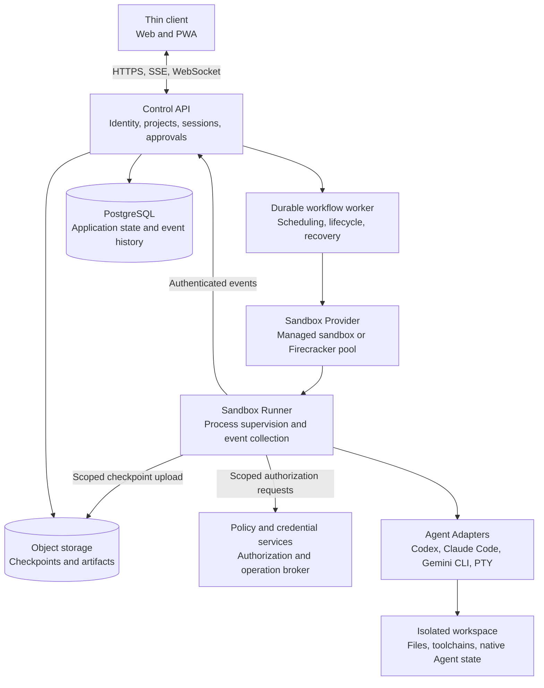

# NexRun Architecture

Status: Proposed architecture; implementation pending  
Updated: 2026-11-04  
Language: English

[Simplified Chinese version](architecture.zh-CN.md)

NexRun is a cloud application for operating multiple CLI Agents through a browser. Users connect a repository, create an isolated workspace, select an Agent, run tasks, review changes, and approve sensitive actions. Execution continues independently of the browser connection.

The architecture combines thin clients, a persistent control plane, and disposable cloud sandboxes. Existing CLI Agents keep their native reasoning loops and context management inside the execution environment. The control plane owns identity, task lifecycle, scheduling, permissions, event history, recovery coordination, and platform resource accounting.

Commercial dependency admission and language conventions are governed by [AGENTS.md](../AGENTS.md). Technology choices below are candidates until exact versions, dependencies, distribution obligations, and applicable service terms pass that policy.

## Goals and scope

The first release should provide a reliable remote development workflow across more than one CLI Agent, with English and Simplified Chinese interfaces. It must preserve project files, make execution observable, recover browser connections, and enforce permissions at actual execution boundaries.

The initial product does not build a replacement Agent reasoning engine. Automatic cross-provider orchestration, custom prompt-cache management, desktop video streaming, autonomous skill creation, and model fine-tuning are later extensions.

Three independent integration concepts keep the system extensible:

- An **Agent Adapter** controls a specific CLI or SDK and translates its events.
- A **Sandbox Provider** provisions and manages the execution environment.
- A **model service configuration** describes the Agent's supported inference connection and authentication. It does not assume that every Agent accepts interchangeable model providers.

## System boundaries



### Thin client

The browser renders conversations, execution activity, approvals, diffs, terminals, previews, and artifacts. It may keep an optimistic view and a local cache, but server state remains authoritative. Closing a tab does not stop an accepted task.

The client never holds cloud infrastructure administration credentials or unrestricted database access. Translation resources and presentation logic belong in the client; authorization decisions do not.

### Control plane

The control plane owns organizations, membership, project configuration, session metadata, execution commands, policy decisions, event persistence, and resource limits. Its API and workflow workers are separately deployable processes sharing well-defined application modules.

Start with a modular monolith rather than many independently deployed services. Preserve module boundaries for identity, workspaces, sessions, execution, approvals, credentials, and billing so they can be separated when load or isolation requirements justify it.

### Execution plane

CLI Agents, repository scripts, build tools, and optional browsers run inside cloud sandboxes. A Runner starts processes, supervises their lifecycle, implements Adapter transports, and reports events. Its credentials authorize only the assigned workspace and execution attempt.

The Runner and repository contents are not trusted to authorize operations or write arbitrary control-plane state. An authenticated event establishes its source, not the truth of every assertion inside it. The platform derives task state through validated protocol transitions.

## Product model and workspace ownership

| Entity | Responsibility |
| --- | --- |
| Organization | Tenant boundary, membership, roles, quotas, and policies |
| Project | Repository connection and shared project configuration |
| Workspace | Durable working copy, branch, environment specification, and access boundary |
| Session | Persistent conversation with one configured Agent |
| Run | One requested execution within a Session |
| Execution attempt | A concrete dispatch of a Run to a Runner, with a lease and fencing token |
| Agent Profile | Agent type, version, model settings, tools, and permission configuration |
| Approval | Authorization for an exact operation under a defined scope and expiry |
| Checkpoint | A versioned record of recoverable workspace and Agent state |
| Artifact | A produced file, patch, report, or other retained output |

A Session can contain many Runs. Runs in one Session execute serially by default. Workspace mutation also requires an exclusive lease, including writes from terminals and auxiliary tools. A second Session must wait or receive a separate working copy.

Parallel development uses independent branches and working copies, normally separate sandboxes. Git worktrees may simplify trusted development within one environment, but they share repository metadata and are not a tenant security boundary. Combine results through a deliberate merge, commit, or pull request flow.

A Workspace outlives its sandbox. Repository URLs and branch names are not sufficient recovery state: uncommitted changes, untracked files, selected Agent session files, and checkpoint manifests must be retained according to project policy.

## User experience

The desktop workspace uses three main areas:

| Area | Contents |
| --- | --- |
| Navigation | Projects, workspaces, sessions, and task status |
| Conversation | User requests, Agent messages, execution activity, and approval cards |
| Inspection | Diff, files, terminal, application preview, and artifacts |

The workspace header identifies the Agent, branch, environment, execution state, and available usage information. Missing provider usage data is shown as unavailable rather than zero.

The initial mobile experience emphasizes progress, replies, and approvals. Full terminal and complex code review interactions can remain desktop-focused.

The primary flow is:

1. Connect a repository and choose an environment template.
2. Create a Workspace and select an Agent Profile.
3. Submit a task and receive confirmation after durable acceptance.
4. Follow activity, inspect changes, and answer supported approval or input requests.
5. Review the result, validation output, and artifacts.
6. Return later to the same Workspace and Session.

## Agent Adapter design

Use official structured interfaces where available, structured headless output next, and a PTY terminal as the compatibility fallback.

| Integration level | Interface | Expected experience |
| --- | --- | --- |
| Structured control | Official bidirectional protocol or SDK | Rich lifecycle, messages, supported approvals, and native session controls |
| Structured output | JSON or JSONL from a headless CLI | Task results and supported execution events; control capabilities vary |
| Terminal | PTY byte stream | Interactive terminal access with limited structured interpretation |

Candidate integrations are Codex App Server, Claude Code Agent SDK or structured CLI output, and Gemini CLI headless output. These interfaces are documented by their respective providers: [Codex App Server](https://developers.openai.com/codex/app-server/), [Claude Code programmatic execution](https://code.claude.com/docs/en/headless), and [Gemini CLI headless mode](https://geminicli.com/docs/cli/headless/).

Each Adapter publishes capabilities for its pinned CLI version and configured mode:

```ts
interface AgentCapabilities {
  structuredEvents: boolean;
  resumeSession: boolean;
  steerActiveRun: boolean;
  interruptRun: boolean;
  toolApproval: boolean;
  usageReporting: boolean;
}
```

The shared lifecycle covers capability discovery, session creation, task submission, event subscription, and cleanup. Resume, steering, interruption, and approval responses are optional operations guarded by capabilities. Terminal control remains a separate interface.

An Adapter maps platform IDs to native session, turn, request, and tool IDs. Persist these mappings with the Agent version and environment specification. Preserve provider-specific details through versioned extensions instead of forcing every event into an inaccurate common abstraction.

Pin Agent versions, explicitly configure enabled tools and plugins, and run Adapter contract tests before upgrades. Treat repository-provided hooks and Agent configuration as executable input subject to workspace trust policy. Do not automatically load host configuration into a new sandbox.

### Steering and interruption

Expose three distinct actions where supported:

- **Steer** adds input to the active execution using a native mechanism.
- **Queue next instruction** waits until the active Run finishes.
- **Interrupt** requests cancellation and reports the actual outcome.

Codex documents separate steering and interruption operations. Other Agents may differ. Do not emulate a safe mid-run redirect by silently killing a process. Cancelling a Run cannot undo an already completed external operation.

### Approval capability

Displaying a tool event does not prove that the platform can stop the tool before execution. Set `toolApproval` only when the configured integration offers an enforceable pre-execution decision path. PTY output parsing alone cannot provide that guarantee.

## Commands and events

Use explicit command APIs and a versioned event envelope rather than a single presentation function as the entire product protocol.

| Channel | Purpose |
| --- | --- |
| HTTPS commands | Create workspaces, submit Runs, request cancellation, and decide approvals |
| SSE | Stream persisted conversation and execution events with reconnect support |
| WebSocket | Carry terminal input, output, and resize interactions |
| Private Runner connection | Authenticated dispatch, heartbeats, acknowledgements, and event ingestion |
| Preview gateway | Authorized access to selected sandbox application ports |

A persisted event includes:

```json
{
  "schemaVersion": 1,
  "eventId": "evt_example",
  "sessionId": "ses_example",
  "runId": "run_example",
  "attemptId": "attempt_example",
  "sequence": 42,
  "type": "message.delta",
  "occurredAt": "2026-11-03T00:00:00Z",
  "payload": { "text": "Inspecting the failing test." }
}
```

The server assigns a monotonically increasing sequence within a Session. Clients deduplicate by event ID and resume from a server-issued cursor. Large output is stored as an artifact rather than embedded indefinitely in the event log. Batch text deltas to reduce write overhead without hiding lifecycle transitions.

Bound stream buffers and disconnect slow consumers with a resumable cursor instead of exhausting server memory. Define event and terminal retention separately. If a cursor has expired, return an explicit resynchronization response with the current Session state and available history; never silently imply that missing output was replayed.

Accept user commands transactionally with an idempotency key and a durable dispatch record. An outbox dispatcher starts or signals the workflow using stable identifiers. If dispatch is retried, it must not create a second logical Run. Persist accepted events before notifying clients; notification failure is recovered through replay.

Validate all object references against the authenticated tenant. Derive tenant identity from authorization context rather than trusting an organization ID supplied by a browser or Runner.

## Durable execution and recovery

Temporal coordinates platform steps such as allocating a sandbox, attaching a workspace, dispatching a Run, waiting for execution status, handling approvals, and retiring resources. Keep token streams and large outputs outside workflow history; store references and lifecycle transitions there.

Temporal Activities can retry. Completed Activities are not re-executed during normal workflow replay, but an operation that completed before its result was recorded may run again. Every external effect therefore needs appropriate idempotency or reconciliation. See [Temporal Activity idempotency](https://docs.temporal.io/activity-definition).

Starting a CLI process is an asynchronous command, not an exactly-once transaction. The Runner keeps a command registry and acknowledges a stable dispatch identifier. Workflow retries first inspect the existing command or attempt. Do not blindly relaunch an Agent after a timeout.

### State ownership

| State | Authority | Recovery approach |
| --- | --- | --- |
| Application entities and event cursor | PostgreSQL | Database recovery and event replay |
| Workflow progression | Temporal | Workflow history and deterministic replay |
| Native conversation | Agent session files and native IDs | Adapter-supported session continuation |
| Workspace files | Persistent storage and checkpoint manifests | Attach a volume or restore a consistent checkpoint |
| Process memory | Live sandbox or optional VM snapshot | Resume where supported; otherwise rebuild the process |
| External side effects | Target service plus operation ledger | Query, deduplicate, or reconcile the result |

PostgreSQL exposes application state, while Temporal owns workflow execution history. These stores do not share a distributed transaction. Use an outbox, stable command IDs, idempotent handlers, and reconciliation to converge their views. Redis-compatible caching must not become a second source of truth.

### Run lifecycle

```text
queued -> provisioning -> running -> succeeded
                            |----> failed
                            |----> waiting_for_approval -> running
                            |----> waiting_for_input -> running
                            |----> cancelling -> cancelled
                            |----> interrupted -> reconciliation_required
```

These are application-level states, not a guarantee that every provider emits matching events. A validated native completion result determines success; a process exit alone may be insufficient. Restoration creates a tracked attempt only after confirming that the previous attempt can no longer execute.

Acquire an execution lease and increasing fencing token for each attempt. The control plane rejects stale writes; controlled operation brokers reject stale execution authority. A disconnected Runner must stop new work when its lease expires. Before replacement, revoke its credentials and terminate or isolate its sandbox, because server-side fencing alone cannot stop arbitrary network traffic from an old process.

### Recovery guarantees

| Guarantee | Promise |
| --- | --- |
| Connection recovery | A browser can reconnect and reconstruct persisted activity while execution continues |
| Session continuation | A supported Agent can continue its saved conversation after process reconstruction |
| Environment recovery | A lost sandbox can be rebuilt from the last durable workspace state |

No general guarantee is made that an arbitrary CLI resumes inside the exact tool call that was in progress. If an external operation may already have happened, enter `reconciliation_required` and inspect its result rather than automatically repeating it.

## Sandbox lifecycle and storage

Define a Sandbox Provider interface around create, inspect, connect, stop, destroy, and supported pause/resume operations. Provisioning requests use stable identifiers. A resource reconciler identifies abandoned sandboxes and retires them after checking active leases.

Start with one managed sandbox provider; E2B is a candidate with documented create, connect, pause, resume, and kill lifecycle operations. Evaluate its selected plan, region, retention, network controls, and commercial terms before adoption. See [E2B sandbox lifecycle](https://e2b.dev/docs/sandbox).

Self-managed Firecracker is a later Provider. It requires a compatible Linux host with KVM and access to `/dev/kvm`; it cannot be assumed to run inside an arbitrary hosting platform. See [Firecracker prerequisites](https://github.com/firecracker-microvm/firecracker/blob/main/docs/getting-started.md).

### Environment composition

- A versioned base image contains the selected toolchain, Runner, and approved Agent binaries.
- A durable project working copy stores source files and uncommitted work.
- A separate Agent state directory stores the session material required for continuation, with a defined retention policy.
- Scoped temporary credentials are supplied only when needed.
- Dependency caches are isolated by tenant, runtime version, and lockfile identity. Shared immutable caches require integrity checks; untrusted tasks cannot overwrite trusted cached content.

Prefer a separate sandbox for each concurrently mutating Workspace. Multiple virtual desktops within one VM do not create separate tenant boundaries. Browser profiles, credentials, and writable state also require appropriate isolation.

### Checkpoints and snapshots

Create workspace checkpoints at defined safe boundaries. Quiesce writers where needed, flush data, save native session state when supported, and publish a manifest only after its referenced objects are durable. A manifest identifies the Agent version, image digest, native session reference, and included files. Exclude secret material where practical and restrict sensitive Agent-state retention.

Keep one active writer for a persistent working copy. A cold rebuild restores the latest completed checkpoint, with any possible gap made visible to the user. The required checkpoint interval and recovery objectives must be measured against actual workload and storage cost.

VM snapshots are optional recovery accelerators, not business transactions or substitutes for durable file storage. Firecracker does not guarantee preserved network connections after restore, and its integrator manages the disk files associated with a snapshot. Reconnect transport channels, refresh credentials, and re-establish leases after restoration. See [Firecracker snapshot support](https://github.com/firecracker-microvm/firecracker/blob/main/docs/snapshotting/snapshot-support.md).

Snapshots can contain credentials in memory or on disk. Encrypt them, enforce tenant access, expire them, and avoid cloning authenticated user state into multiple environments. Reinitialize per-instance identity and entropy when using shared warm templates.

Suspend idle environments only when no task or protected interaction is active. Bound warm-pool size, storage retention, and total resource lifetime so abandoned sessions do not produce unlimited cost.

## Security and authorization

### Identity and isolation

Use OIDC for platform identity and organization-scoped roles. Authorize every API call, event subscription, artifact download, terminal attachment, and preview request. Apply tenant-scoped queries, with database row policies where appropriate as defense in depth. Sign artifact links with short lifetimes and avoid exposing storage keys as authorization.

Execute repository code only inside the sandbox. Apply process, CPU, memory, disk, and time limits. Keep host infrastructure credentials, control-plane database credentials, and privileged management sockets outside the sandbox. Restrict access to metadata endpoints, private networks, and management services.

### Permission profiles

| Profile | Intended scope |
| --- | --- |
| Read-only analysis | Inspect source and produce analysis without workspace writes or external side effects |
| Workspace development | Modify the assigned working copy and run permitted build/test commands |
| Controlled publishing | Perform explicitly authorized external operations through controlled paths |

Read-only mode requires actual filesystem, tool, and network restrictions; an instruction in a prompt is insufficient. Use the strongest enforcement supported by the sandbox and Agent combination. Disable a profile if the selected combination cannot enforce it.

### Approval execution

Bind each approval to the requester identity, tenant, Run, attempt, native request ID, canonical operation hash, scope, expiry, and single-use execution identifier. Present the concrete command, target, draft, or proposed change. Revalidate authorization at execution time, and require a new approval if the operation changes. Do not interpret arbitrary chat text as an approval token.

For sensitive publishing, withhold privileged credentials from arbitrary shell processes and route the operation through an authenticated broker. Enforce network and credential boundaries so a second tool cannot bypass the approved path. An allowed hostname alone does not distinguish read and write operations on that service.

An optional model reviewer can help classify requests, but cannot replace enforceable access controls. External documents, tool output, and repository instructions are untrusted input and cannot grant platform permissions.

### Credential handling

Prefer short-lived, minimally scoped tokens. Encrypt stored secrets with managed keys and keep secret values out of prompts, telemetry, and approval text. Where feasible, an operation broker holds credentials outside the sandbox and performs the authorized request.

If a credential is injected into a process environment or readable file, treat it as accessible to that execution environment. Log redaction reduces accidental exposure but does not make a readable credential invisible to an Agent.

Each CLI and model service needs its own compliant authentication design. In particular, Claude Code hosting is subject to conditions on unmodified binaries, native authentication, end-user credentials, and direct usage billing. Do not assume that an SDK license permits reselling usage or collecting Claude.ai session tokens. See [Claude Code legal and compliance](https://code.claude.com/docs/en/legal-and-compliance).

### Browser and terminal surfaces

Render Markdown and terminal output defensively. Filter unsafe links and control sequences; do not execute arbitrary HTML from an Agent message. Keep application previews on a separate origin from the control console, use scoped authorization, and limit forwarded ports. Treat preview content as untrusted code.

Desktop streaming and human browser takeover are later features with separate authorization and browser-profile isolation requirements. They are not prerequisites for the CLI MVP.

## Internationalization and development languages

English is the primary product and development language. Simplified Chinese is the secondary supported language. Additional locales can be added without changing protocol identifiers.

Maintain separate English and Simplified Chinese documents with equivalent coverage and matching technical decisions. Do not combine the two languages into a single document or replace the Chinese version with a summary. Link the companion versions and update them together when architecture decisions change.

| Concern | Rule |
| --- | --- |
| UI locale | Default to `en`, support `zh-CN`, and preserve explicit user selection |
| Translation resources | Use stable keys, matching catalogs, and ICU-style formatting |
| User-facing errors | Return stable codes and parameters; localize presentation |
| Agent response language | Configure per Session independently of UI locale |
| Raw technical content | Preserve code, paths, commands, and CLI errors; offer translation separately |
| Development artifacts | Use English for identifiers, comments, APIs, logs, tests, primary docs, and PRs |
| Time and formatting | Store timestamps consistently and render with user locale and timezone |
| Future scheduled tasks | Store the schedule timezone explicitly; do not infer it from UI language |

Test streaming UTF-8 decoding, Chinese input methods, wide terminal characters, pluralization, and missing translation keys. Approval meaning and authorization hashes derive from the underlying operation, not its translated label.

Programming-language support is a separate capability. Offer versioned environment templates for Node.js/TypeScript, Python, Go, and later other toolchains. The platform protocol remains language-neutral. Linux sandboxes do not imply support for native Windows or macOS execution.

## Candidate technology stack

| Layer | Candidate | Rationale |
| --- | --- | --- |
| Web client | React, Vite, TypeScript | Interactive workspace with a separate API boundary |
| Internationalization | i18next with ICU support | English source catalog and Chinese translations |
| Control API | Fastify and TypeScript | Typed Node.js service with schema validation |
| Contracts | JSON Schema, TypeBox, OpenAPI | Versioned transport and generated API documentation |
| Application database | PostgreSQL | Durable relational state and event indexes |
| Workflow execution | Temporal | Persistent lifecycle coordination and asynchronous waits |
| Cache and rate limiting | Valkey | Cache candidate with a BSD-3-Clause main-project license |
| Object storage | S3-compatible storage | Workspace checkpoints, logs, and artifacts |
| Live updates | SSE and WebSocket | Separate event replay from terminal interaction |
| Authentication | OIDC | Platform identity and organization integration |
| Observability | OpenTelemetry and structured logs | Correlated platform and execution diagnostics |

Temporal is the workflow scheduler. Valkey handles ephemeral caching and rate limiting, not a parallel durable task scheduler. Persistent commands and events remain in PostgreSQL and workflow history as appropriate.

Valkey replaces the earlier unspecified Redis candidate. Redis licensing varies by version, so it must not be treated as uniformly permissive. Valkey's own modules, clients, dependencies, and images still require separate review. See [Valkey license](https://github.com/valkey-io/valkey/blob/unstable/COPYING) and [Redis version licenses](https://redis.io/legal/licenses/).

## Commercial dependency admission

Apply [the repository dependency policy](../AGENTS.md#commercial-use-and-third-party-dependency-admission) to every selected package and release artifact. Prefer permissive application dependencies while fulfilling their license and notice requirements. Copyleft does not mean noncommercial, but application-library exceptions need the review specified in that policy.

The dependency inventory records exact versions or digests, source, license evidence, selected license branches, usage/distribution model, obligations, and review status. Include transitive dependencies, development tools that contribute code to bundles, downloaded binaries, fonts, icons, and copied code.

At initialization, add reproducible installation and a license CI gate. Unknown or policy-incompatible changes fail the gate. At release, generate an SBOM and third-party notices for the actual deliverables. Review OS and system-component distribution separately for customer-hosted images.

Review hosted services, CLI terms, model access, and trademarks independently from code licenses. A permissively licensed SDK and a user-supplied key do not establish rights to host or resell the underlying service. Automated scanning provides review evidence, not a blanket legal guarantee.

## Deployment and operations

Deploy the Web client, API, and workflow worker independently. Prefer managed PostgreSQL, durable object storage, and an operated Temporal service when they fit the budget and deployment requirements. The execution plane is a separately isolated pool reached through the Sandbox Provider.

Local development can run the API and worker against local infrastructure and a restricted development Runner. A local Runner is not the production boundary for hostile multi-tenant workloads. The Mac development environment does not need to host Firecracker; integration tests can target a managed sandbox or compatible Linux host.

Use organization, project, Session, Run, and attempt identifiers to correlate logs and traces. Record queue delay, sandbox allocation time, first-event latency, execution failures, reconnect success, checkpoint age, approval waits, and resource consumption. Keep operational telemetry separate from user content and apply retention limits and secret filtering.

Provider usage statistics may be missing or estimated. Track platform compute/storage separately from model charges, and do not present an estimate as an invoice. Enforce execution time, concurrency, CPU/memory, disk, artifact, and retention quotas even when model usage cannot be measured precisely.

Back up application data and required workflow state, define object retention, and test restoration. Define measurable recovery point and recovery time objectives before production release. Trace retention, checkpoint retention, and account deletion must agree so deleted content is not indefinitely retained through secondary stores.

## Repository layout

```text
nexrun/
├── apps/
│   ├── web/                  # English-first multilingual workspace
│   ├── api/                  # Control plane API
│   ├── worker/               # Durable workflows and reconciliation
│   └── runner/               # Sandbox process supervision
├── packages/
│   ├── protocol/             # Commands, events, errors, and capabilities
│   ├── adapters/             # Agent integrations
│   ├── sandbox/              # Sandbox Provider integrations
│   ├── policy/               # Permission and approval logic
│   ├── db/                   # Data model and migrations
│   └── i18n/                 # English and Chinese resources
├── docs/
│   ├── architecture.md        # English architecture
│   └── architecture.zh-CN.md  # Simplified Chinese architecture
└── infra/                    # Local and cloud deployment configuration
```

This layout describes the implementation target. Modules should share typed contracts without coupling the Web client directly to Runner or provider internals.

## Delivery plan and acceptance criteria

### Foundation

Initialize the TypeScript workspace, versioned contracts, PostgreSQL migrations, identity, and license checks. Add English and Chinese catalogs from the first screen. Establish command idempotency, persisted events, and a fake Adapter for deterministic integration tests.

### Remote execution MVP

Integrate one sandbox provider and two structured Agent Adapters, with Codex and Claude Code as initial candidates subject to terms review. Add PTY fallback with clear capability limits. Deliver repository import, isolated workspaces, task submission, streaming, diffs, artifacts, supported approvals, native session continuation, and resource limits.

Validate the following before calling the MVP complete:

1. Closing the browser does not stop an accepted Run; reconnecting reconstructs persisted events without duplicate messages.
2. Repeating a submission with the same idempotency key creates one logical Run.
3. API or worker restart does not blindly relaunch an acknowledged Agent process.
4. Workspace files, including uncommitted changes covered by a checkpoint, survive sandbox replacement.
5. Recovery describes its boundary accurately and does not silently repeat an operation whose external result is unknown.
6. Concurrent tasks cannot write the same working copy without the required lease.
7. Expired, replayed, stale-attempt, or changed-operation approvals cannot authorize execution.
8. A denied sensitive operation cannot be performed through an alternative shell path using platform-held credentials.
9. Cross-tenant API, event, terminal, preview, and artifact requests are rejected.
10. English and Chinese screens, errors, approvals, input methods, and reconnect states behave consistently.
11. Resolved dependencies and actual release artifacts pass the commercial admission policy and include required notices.

Use Adapter contract tests, Runner lifecycle tests, workflow failure injection, tenant-boundary tests, and targeted end-to-end scenarios to verify these properties. Test node loss, duplicate callbacks, stale leases, slow event consumers, and incomplete checkpoint uploads.

### Subsequent releases

Add Gemini CLI structured integration, additional environment templates, schedules and webhook triggers, notification controls, and provider portability. Introduce desktop streaming, richer collaboration, controlled multi-Agent orchestration, and a self-managed Firecracker pool only after execution and recovery behavior are established.

Future external triggers require authenticated ingestion and deduplication. User instructions receive scheduling priority; low-priority work can wait, while interruption still follows Adapter capabilities. Background progress remains quiet unless completion, failure, blocking input, or an approval needs attention.

## Decisions to validate before implementation

| Decision | Required validation |
| --- | --- |
| First sandbox provider | Commercial terms, target region, isolation, network policy, storage durability, and pause/resume behavior |
| Agent versions and authentication | Exact protocol behavior, native state retention, hosting rights, and supported user authorization flows |
| Storage implementation | Persistent-volume portability or checkpoint strategy, consistency boundary, and recovery cost |
| Workflow deployment | Managed versus self-operated Temporal, operating cost, and backup responsibilities |
| Publishing operations | Which actions the MVP supports and which broker paths enforce them |
| Recovery objectives | Acceptable checkpoint gap, restoration latency, retention, and measured costs |
| Distribution model | Hosted SaaS first; reassess obligations before shipping customer-hosted images |
