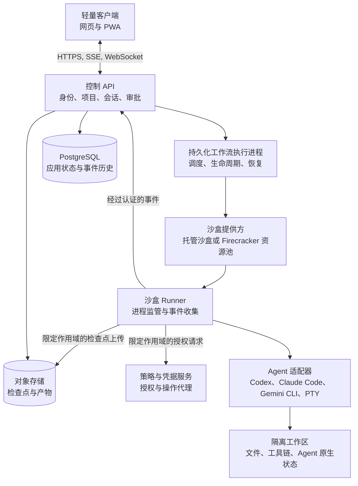

# NexRun 架构设计

状态：架构提案；尚待实现  
更新日期：2026-11-04  
语言：简体中文

[英文版](architecture.md)

NexRun 是一个通过浏览器操作多个 CLI Agent 的云应用。用户可以连接代码仓库、创建隔离的工作区、选择 Agent、运行任务、审查变更，并批准敏感操作。执行过程独立于浏览器连接持续运行。

该架构由轻量客户端、持久化控制面和可随时替换的云沙盒组成。现有 CLI Agent 在执行环境中保留其原生推理循环和上下文管理方式。控制面负责身份、任务生命周期、调度、权限、事件历史、恢复协调，以及平台资源用量核算。

商业依赖准入和语言约定由 [AGENTS.md](../AGENTS.md) 规定。下文列出的技术选择均为候选方案，只有在具体版本、依赖、分发义务和适用服务条款通过该策略的审查后才能采用。

## 目标与范围

首个版本应提供可靠的远程开发工作流，支持多个 CLI Agent，并提供英文和简体中文界面。它必须保留项目文件、提供执行可观测性、支持浏览器重新连接，并在实际执行边界落实权限控制。

初期产品不会构建替代现有 Agent 的推理引擎。跨提供方自动编排、自定义提示缓存管理、桌面视频流、自主创建技能和模型微调属于后续扩展。

以下三个相互独立的集成概念用于保持系统的可扩展性：

- **Agent 适配器**控制特定的 CLI 或 SDK，并转换其事件。
- **沙盒提供方**负责供应和管理执行环境。
- **模型服务配置**描述 Agent 所支持的推理连接和身份认证方式。它不假定所有 Agent 都能接受相互替换的模型提供方。

## 系统边界



### 轻量客户端

浏览器呈现对话、执行活动、审批、差异、终端、预览和产物。它可以维护乐观更新视图和本地缓存，但服务端状态始终具有权威性。关闭标签页不会停止已受理的任务。

客户端绝不持有云基础设施管理凭据或不受限的数据库访问权限。翻译资源和展示逻辑属于客户端职责，授权决策则不属于。

### 控制面

控制面负责组织、成员关系、项目配置、会话元数据、执行命令、策略决策、事件持久化和资源限制。其 API 与工作流执行进程可以分别部署，并共享边界明确的应用模块。

初期采用模块化单体，而不是大量独立部署的服务。为身份、工作区、会话、执行、审批、凭据和计费保留模块边界，以便在负载或隔离要求达到相应程度时将其拆分。

### 执行面

CLI Agent、仓库脚本、构建工具和可选浏览器在云沙盒内运行。Runner 启动进程、监管其生命周期、实现适配器传输机制，并上报事件。其凭据仅授权访问分配给它的工作区和执行尝试。

Runner 和仓库内容都不具备授权操作或任意写入控制面状态的可信权限。经过身份认证的事件只能证明其来源，不能证明其中每项陈述都真实。平台通过经过校验的协议状态转换来推导任务状态。

## 产品模型与工作区归属

| 实体 | 职责 |
| --- | --- |
| Organization | 租户边界、成员关系、角色、配额和策略 |
| Project | 仓库连接和共享项目配置 |
| Workspace | 持久化工作副本、分支、环境规格和访问边界 |
| Session | 与一个已配置 Agent 进行的持久对话 |
| Run | Session 内一次请求执行 |
| Execution attempt | 将一次 Run 具体派发给某个 Runner，并附带租约和隔离令牌 |
| Agent Profile | Agent 类型、版本、模型设置、工具和权限配置 |
| Approval | 在明确的作用域和有效期内对某项精确操作的授权 |
| Checkpoint | 可恢复的工作区和 Agent 状态的版本化记录 |
| Artifact | 生成的文件、补丁、报告或其他保留输出 |

一个 Session 可以包含多次 Run。同一 Session 内的 Run 默认串行执行。对 Workspace 的修改也需要独占租约，包括来自终端和辅助工具的写入。第二个 Session 必须等待，或使用独立的工作副本。

并行开发使用独立分支和工作副本，通常也使用独立沙盒。Git worktree 可以简化同一环境内的可信开发，但它们共享仓库元数据，不能作为租户安全边界。通过明确的合并、提交或拉取请求流程整合结果。

Workspace 的存续时间长于其沙盒。仅有仓库 URL 和分支名称不足以支持恢复：必须按照项目策略保留未提交的变更、未跟踪文件、选定的 Agent 会话文件，以及检查点清单。

## 用户体验

桌面工作区使用三个主要区域：

| 区域 | 内容 |
| --- | --- |
| 导航 | 项目、工作区、会话和任务状态 |
| 对话 | 用户请求、Agent 消息、执行活动和审批卡片 |
| 检查 | 差异、文件、终端、应用预览和产物 |

工作区顶部显示 Agent、分支、环境、执行状态和可获取的用量信息。提供方未返回的用量数据显示为不可用，而不是零。

初期移动端体验以查看进度、回复和审批为重点。完整终端和复杂代码审查交互可以继续以桌面端为主。

主要流程如下：

1. 连接仓库并选择环境模板。
2. 创建 Workspace 并选择 Agent Profile。
3. 提交任务，在任务被持久化受理后收到确认。
4. 跟进活动、检查变更，并响应受支持的审批或输入请求。
5. 审查结果、验证输出和产物。
6. 稍后返回同一 Workspace 和 Session。

## Agent 适配器设计

优先使用官方结构化接口，其次使用结构化无界面输出，最后以 PTY 终端作为兼容性后备方案。

| 集成层级 | 接口 | 预期体验 |
| --- | --- | --- |
| 结构化控制 | 官方双向协议或 SDK | 丰富的生命周期、消息、受支持的审批和原生会话控制 |
| 结构化输出 | 无界面 CLI 输出的 JSON 或 JSONL | 任务结果和受支持的执行事件；控制能力因集成而异 |
| 终端 | PTY 字节流 | 交互式终端访问，结构化解析能力有限 |

候选集成包括 Codex App Server、Claude Code Agent SDK 或结构化 CLI 输出，以及 Gemini CLI 无界面输出。这些接口分别由其提供方编写文档：[Codex App Server](https://developers.openai.com/codex/app-server/)、[Claude Code 程序化执行](https://code.claude.com/docs/en/headless) 和 [Gemini CLI 无界面模式](https://geminicli.com/docs/cli/headless/)。

每个适配器针对其固定的 CLI 版本和配置模式声明能力：

```ts
interface AgentCapabilities {
  structuredEvents: boolean;
  resumeSession: boolean;
  steerActiveRun: boolean;
  interruptRun: boolean;
  toolApproval: boolean;
  usageReporting: boolean;
}
```

共享生命周期涵盖能力发现、会话创建、任务提交、事件订阅和清理。恢复、执行中引导、中断和审批响应属于可选操作，必须依据能力声明决定是否启用。终端控制保留为独立接口。

适配器将平台 ID 映射到原生会话、轮次、请求和工具 ID。将这些映射与 Agent 版本和环境规格一同持久化。通过版本化扩展保留提供方特有的细节，不要将所有事件强行套入失真的通用抽象。

固定 Agent 版本，显式配置启用的工具和插件，并在升级前运行适配器契约测试。将仓库提供的钩子和 Agent 配置视为受工作区信任策略约束的可执行输入。不要自动将宿主机配置加载到新沙盒中。

### 执行中引导与中断

在受支持的情况下，提供三个独立操作：

- **执行中引导**通过原生机制向正在执行的任务追加输入。
- **排队下一条指令**等待当前 Run 结束。
- **中断**请求取消，并报告实际结果。

Codex 为执行中引导和中断提供了不同的操作文档。其他 Agent 的行为可能不同。不要通过静默终止进程来模拟安全的执行中转向。取消一次 Run 无法撤销已经完成的外部操作。

### 审批能力

显示工具事件并不能证明平台有能力在工具执行前阻止它。只有在所配置的集成提供可强制执行的执行前决策路径时，才能将 `toolApproval` 设为启用。仅解析 PTY 输出无法提供这一保证。

## 命令与事件

使用显式命令 API 和版本化事件封装，而不是用单一的展示函数充当整个产品协议。

| 通道 | 用途 |
| --- | --- |
| HTTPS 命令 | 创建 Workspace、提交 Run、请求取消和作出审批决定 |
| SSE | 以流方式传送已持久化的对话和执行事件，并支持重新连接 |
| WebSocket | 承载终端输入、输出和尺寸调整交互 |
| Runner 私有连接 | 经过认证的派发、心跳、确认和事件接收 |
| 预览网关 | 经授权访问选定的沙盒应用端口 |

持久化事件包含以下内容：

```json
{
  "schemaVersion": 1,
  "eventId": "evt_example",
  "sessionId": "ses_example",
  "runId": "run_example",
  "attemptId": "attempt_example",
  "sequence": 42,
  "type": "message.delta",
  "occurredAt": "2026-11-03T00:00:00Z",
  "payload": { "text": "Inspecting the failing test." }
}
```

服务端在每个 Session 内分配单调递增的序号。客户端按事件 ID 去重，并从服务端签发的游标处恢复。大型输出保存为产物，而不是无限制地内嵌在事件日志中。批量处理文本增量以减少写入开销，同时确保生命周期转换不会被隐藏。

为流缓冲区设定上限，并断开消费速度过慢的客户端连接，同时提供可恢复的游标，以免耗尽服务端内存。分别定义事件和终端的保留策略。如果游标已过期，应返回明确的重新同步响应，附带当前 Session 状态和可用历史记录；绝不能静默暗示缺失的输出已被重放。

通过事务受理用户命令，并使用幂等键和持久化派发记录。发件箱派发器使用稳定标识符启动工作流或向其发送信号。如果重试派发，不得创建第二次逻辑 Run。先持久化已受理的事件，再通知客户端；通知失败通过重放恢复。

依据已认证租户校验所有对象引用。从授权上下文推导租户身份，不信任浏览器或 Runner 提供的组织 ID。

## 持久化执行与恢复

Temporal 协调平台步骤，例如分配沙盒、挂载 Workspace、派发 Run、等待执行状态、处理审批和回收资源。令牌流和大型输出不进入工作流历史；历史中只保存引用和生命周期转换。

Temporal Activity 可以重试。正常工作流重放不会重新执行已完成的 Activity，但如果操作已完成而结果尚未记录，该操作仍可能再次运行。因此，每项外部副作用都需要适当的幂等机制或结果核对机制。参见 [Temporal Activity 幂等性](https://docs.temporal.io/activity-definition)。

启动 CLI 进程是异步命令，不是精确执行一次的事务。Runner 维护命令登记表，并确认稳定的派发标识符。工作流重试时首先检查已有命令或执行尝试。不要在超时后盲目重新启动 Agent。

### 状态归属

| 状态 | 权威来源 | 恢复方式 |
| --- | --- | --- |
| 应用实体和事件游标 | PostgreSQL | 数据库恢复与事件重放 |
| 工作流进展 | Temporal | 工作流历史和确定性重放 |
| 原生对话 | Agent 会话文件和原生 ID | 通过适配器支持的方式继续会话 |
| 工作区文件 | 持久存储和检查点清单 | 挂载卷或恢复一致的检查点 |
| 进程内存 | 运行中的沙盒或可选 VM 快照 | 在受支持时恢复；否则重建进程 |
| 外部副作用 | 目标服务与操作账本 | 查询、去重或核对结果 |

PostgreSQL 提供应用状态，Temporal 则掌管工作流执行历史。这些存储之间没有共享的分布式事务。使用发件箱、稳定命令 ID、幂等处理程序和状态核对，使它们的视图最终一致。兼容 Redis 的缓存不得成为第二个事实来源。

### Run 生命周期

```text
queued -> provisioning -> running -> succeeded
                            |----> failed
                            |----> waiting_for_approval -> running
                            |----> waiting_for_input -> running
                            |----> cancelling -> cancelled
                            |----> interrupted -> reconciliation_required
```

这些是应用级状态，并不保证每个提供方都发出对应事件。成功由经过校验的原生完成结果确定；仅有进程退出可能不足以判定成功。恢复时，只有在确认先前的执行尝试已无法继续执行后，才创建受跟踪的新尝试。

每次执行尝试都需获取执行租约和递增的隔离令牌。控制面拒绝过期写入；受控操作代理拒绝过期的执行权限。Runner 断开连接后，必须在租约过期时停止新工作。在替换 Runner 前，先撤销其凭据，并终止或隔离其沙盒，因为仅依靠服务端隔离令牌无法阻止旧进程发出任意网络流量。

### 恢复保证

| 保证 | 承诺 |
| --- | --- |
| 连接恢复 | 浏览器可以重新连接，并在执行持续进行时重建已持久化的活动 |
| 会话继续 | 受支持的 Agent 可以在进程重建后继续已保存的对话 |
| 环境恢复 | 丢失的沙盒可以根据最近持久化的工作区状态重建 |

系统不普遍保证任意 CLI 都能在先前正在进行的工具调用内部精确恢复。如果外部操作可能已经发生，应进入 `reconciliation_required` 并检查其结果，而不是自动重复该操作。

## 沙盒生命周期与存储

定义沙盒提供方接口，涵盖创建、检查、连接、停止、销毁，以及受支持的暂停和恢复操作。供应请求使用稳定标识符。资源核对器识别遗弃沙盒，并在检查活跃租约后将其回收。

初期采用一个托管沙盒提供方；E2B 是候选方案，其文档涵盖创建、连接、暂停、恢复和终止等生命周期操作。采用前应评估所选套餐、区域、保留策略、网络控制和商业条款。参见 [E2B 沙盒生命周期](https://e2b.dev/docs/sandbox)。

自主管理的 Firecracker 是后续提供方方案。它需要兼容的 Linux 宿主机、KVM 和 `/dev/kvm` 访问权限；不能假定它可在任意托管平台内部运行。参见 [Firecracker 前置条件](https://github.com/firecracker-microvm/firecracker/blob/main/docs/getting-started.md)。

### 环境组成

- 版本化基础镜像包含选定的工具链、Runner 和已获准使用的 Agent 二进制文件。
- 持久化项目工作副本保存源文件和未提交的工作。
- 独立的 Agent 状态目录保存继续会话所需的材料，并制定明确的保留策略。
- 仅在需要时提供限定作用域的临时凭据。
- 依赖缓存按租户、运行时版本和锁文件标识隔离。共享的不可变缓存需要完整性检查；不可信任务不得覆盖可信缓存内容。

对于每个可能并发修改的 Workspace，优先使用独立沙盒。同一 VM 中的多个虚拟桌面不会形成独立的租户边界。浏览器配置档案、凭据和可写状态也需要适当隔离。

### 检查点与快照

在明确的安全边界创建工作区检查点。必要时暂停写入并刷新数据，在支持时保存原生会话状态，且只有在清单引用的对象均已持久化后才发布清单。清单标识 Agent 版本、镜像摘要、原生会话引用和所含文件。在可行时排除机密材料，并限制敏感 Agent 状态的保留。

每个持久化工作副本仅保留一个活跃写入方。冷重建恢复最近一次已完成的检查点，并向用户明确展示任何可能的数据缺口。必须结合实际工作负载和存储成本衡量所需的检查点间隔与恢复目标。

VM 快照是可选的恢复加速手段，不是业务事务，也不能替代持久文件存储。Firecracker 不保证恢复后仍保留网络连接，且由其集成方管理快照关联的磁盘文件。恢复后应重新连接传输通道、刷新凭据并重新建立租约。参见 [Firecracker 快照支持](https://github.com/firecracker-microvm/firecracker/blob/main/docs/snapshotting/snapshot-support.md)。

快照可能在内存或磁盘中包含凭据。应对其加密、落实租户访问控制、设置过期机制，并避免将已认证的用户状态克隆到多个环境。在使用共享预热模板时，应重新初始化每个实例的身份和熵。

仅在没有活跃任务或受保护交互时挂起空闲环境。为预热资源池规模、存储保留期限和总资源寿命设定上限，防止遗弃会话产生无上限的费用。

## 安全与授权

### 身份与隔离

使用 OIDC 管理平台身份和组织范围内的角色。对每一次 API 调用、事件订阅、产物下载、终端连接和预览请求进行授权检查。将查询限定在租户范围内，并在适当情况下使用数据库行级策略作为纵深防御。为产物链接设置短有效期的签名，避免将暴露的存储键用作授权凭据。

仅在沙盒内执行仓库代码。施加进程、CPU、内存、磁盘和时间限制。将宿主基础设施凭据、控制面数据库凭据和特权管理套接字保留在沙盒之外。限制对元数据端点、私有网络和管理服务的访问。

### 权限配置

| 配置 | 预期范围 |
| --- | --- |
| 只读分析 | 检查源代码并生成分析，不写入工作区，也不产生外部副作用 |
| 工作区开发 | 修改分配的工作副本，并运行获准的构建和测试命令 |
| 受控发布 | 通过受控路径执行明确授权的外部操作 |

只读模式需要实际的文件系统、工具和网络限制；仅在提示词中加入指令并不足够。使用沙盒与 Agent 组合所支持的最强执行约束。如果所选组合无法强制执行某个权限配置，则禁用该配置。

### 审批执行

将每次审批绑定到请求者身份、租户、Run、attempt、原生请求 ID、规范化操作哈希、范围、过期时间和一次性执行标识。展示具体命令、目标、草稿或拟议变更。在执行时重新验证授权；如果操作发生变化，则要求重新审批。不要将任意聊天文本解释为审批令牌。

对于敏感发布操作，不向任意 shell 进程提供特权凭据，而是通过经过身份验证的代理服务执行操作。强制实施网络和凭据边界，防止第二种工具绕过已批准的路径。仅允许某个主机名，并不能区分对该服务的读取与写入操作。

可选的模型审查器可以协助对请求分类，但不能替代可强制执行的访问控制。外部文档、工具输出和仓库指令都是不可信输入，不能授予平台权限。

### 凭据处理

优先使用短期、最小权限范围的令牌。使用托管密钥加密存储的秘密信息，并避免在提示词、遥测数据和审批文本中包含秘密值。在可行的情况下，由操作代理服务在沙盒外保管凭据并执行已授权请求。

如果凭据被注入进程环境或可读取的文件，应将其视为该执行环境可访问的信息。日志脱敏可减少意外泄露，但不能让 Agent 看不到可读取的凭据。

每个 CLI 和模型服务都需要各自合规的身份验证设计。尤其是，Claude Code 托管受有关未修改二进制文件、原生身份验证、最终用户凭据和直接用量计费的条件约束。不要假定 SDK 许可证允许转售用量或收集 Claude.ai 会话令牌。参见 [Claude Code 法律与合规说明](https://code.claude.com/docs/en/legal-and-compliance)。

### 浏览器与终端界面

以防御性方式渲染 Markdown 和终端输出。过滤不安全链接和控制序列；不要执行 Agent 消息中的任意 HTML。将应用预览与控制台放在不同的源上，使用限定范围的授权，并限制转发端口。将预览内容视为不可信代码。

桌面流式传输和人工浏览器接管属于后续功能，具有独立的授权和浏览器配置文件隔离要求。它们不是 CLI MVP 的前置条件。

## 国际化与开发语言

英语是主要的产品和开发语言。简体中文是第二支持语言。新增语言区域时无需更改协议标识符。

维护覆盖范围相当、技术决策一致的独立英文文档和简体中文文档。不要将两种语言合并到同一文档中，也不要用摘要代替中文版。为两个版本添加相互链接，并在架构决策变化时同步更新。

| 关注点 | 规则 |
| --- | --- |
| UI 语言区域 | 默认使用 `en`，支持 `zh-CN`，并保留用户的明确选择 |
| 翻译资源 | 使用稳定键、相互匹配的资源目录和 ICU 风格的格式化 |
| 面向用户的错误 | 返回稳定代码和参数；在展示层进行本地化 |
| Agent 回复语言 | 按 Session 配置，独立于 UI 语言区域 |
| 原始技术内容 | 保留代码、路径、命令和 CLI 错误；另行提供翻译 |
| 开发产物 | 标识符、注释、API、日志、测试、主要文档和 PR 使用英语 |
| 时间与格式化 | 以一致方式存储时间戳，并按用户的语言区域和时区展示 |
| 未来的定时任务 | 显式存储调度时区；不要根据 UI 语言推断时区 |

测试流式 UTF-8 解码、中文输入法、终端宽字符、复数形式和缺失的翻译键。审批含义和授权哈希由底层操作决定，而非其翻译后的标签。

编程语言支持是一项独立能力。为 Node.js/TypeScript、Python、Go 以及后续其他工具链提供版本化环境模板。平台协议保持语言中立。Linux 沙盒并不意味着支持原生 Windows 或 macOS 执行。

## 候选技术栈

| 层级 | 候选技术 | 理由 |
| --- | --- | --- |
| Web 客户端 | React、Vite、TypeScript | 具有独立 API 边界的交互式工作区 |
| 国际化 | 支持 ICU 的 i18next | 英文源资源目录和中文翻译 |
| 控制 API | Fastify 和 TypeScript | 具有类型和模式验证的 Node.js 服务 |
| 契约 | JSON Schema、TypeBox、OpenAPI | 版本化传输协议和生成的 API 文档 |
| 应用数据库 | PostgreSQL | 持久化关系状态和事件索引 |
| 工作流执行 | Temporal | 持久化生命周期协调和异步等待 |
| 缓存与速率限制 | Valkey | 主项目采用 BSD-3-Clause 许可证的缓存候选技术 |
| 对象存储 | 兼容 S3 的存储 | 工作区检查点、日志和产物 |
| 实时更新 | SSE 和 WebSocket | 将事件重放与终端交互分离 |
| 身份验证 | OIDC | 平台身份和组织集成 |
| 可观测性 | OpenTelemetry 和结构化日志 | 关联平台与执行诊断信息 |

Temporal 是工作流调度器。Valkey 处理临时缓存和速率限制，不作为另一套并行的持久化任务调度器。持久化命令和事件根据需要保留在 PostgreSQL 和工作流历史中。

Valkey 取代此前未指定版本的 Redis 候选方案。Redis 的许可证随版本而异，因此不能将其统一视为宽松许可证。Valkey 自身的模块、客户端、依赖项和镜像仍需单独审查。参见 [Valkey 许可证](https://github.com/valkey-io/valkey/blob/unstable/COPYING) 和 [Redis 各版本许可证](https://redis.io/legal/licenses/)。

## 商业依赖准入

对每个选定的软件包和发布产物应用[仓库依赖政策](../AGENTS.md#commercial-use-and-third-party-dependency-admission)。优先选择宽松许可证的应用依赖，同时履行其许可证和声明要求。Copyleft 不等于禁止商用，但应用库的例外准入需要经过该政策规定的审查。

依赖清单记录精确版本或摘要、来源、许可证证据、选定的许可证分支、使用与分发模式、义务和审查状态。清单应涵盖传递依赖、向打包产物贡献代码的开发工具、下载的二进制文件、字体、图标和复制的代码。

初始化时加入可复现安装和许可证 CI 门禁。未知或不符合政策的变更必须使门禁检查失败。发布时，针对实际交付物生成 SBOM 和第三方声明。对于客户托管镜像，单独审查操作系统和系统组件的分发事项。

将托管服务、CLI 条款、模型访问和商标与代码许可证分别审查。宽松许可证的 SDK 和用户自备密钥，并不能证明具有托管或转售底层服务的权利。自动化扫描提供审查证据，而非全面的法律保证。

## 部署与运维

独立部署 Web 客户端、API 和工作流 worker。在符合预算与部署要求时，优先使用托管 PostgreSQL、持久化对象存储和代运维的 Temporal 服务。执行面是一个单独隔离的资源池，通过 Sandbox Provider 访问。

本地开发可以使用本地基础设施和受限的开发 Runner 来运行 API 与 worker。本地 Runner 不能作为承载恶意多租户工作负载的生产隔离边界。Mac 开发环境无需托管 Firecracker；集成测试可以面向托管沙盒或兼容的 Linux 主机。

使用组织、项目、Session、Run 和 attempt 标识关联日志与追踪。记录排队延迟、沙盒分配时间、首事件延迟、执行失败、重连成功率、检查点距今时长、审批等待和资源消耗。将运维遥测与用户内容分开，并实施保留期限和秘密信息过滤。

服务提供方的用量统计可能缺失或仅为估算。分别跟踪平台计算与存储消耗和模型费用，不要将估算呈现为账单。即使无法精确计量模型用量，也要强制执行运行时间、并发数、CPU/内存、磁盘、产物和保留期限配额。

备份应用数据和必需的工作流状态，定义对象保留策略，并测试恢复。在生产发布前定义可衡量的恢复点目标和恢复时间目标。追踪数据保留、检查点保留和账号删除策略必须协调一致，避免已删除内容通过次级存储被无限期保留。

## 仓库布局

```text
nexrun/
├── apps/
│   ├── web/                  # 英文优先的多语言工作台
│   ├── api/                  # 控制面 API
│   ├── worker/               # 持久化工作流与状态核对
│   └── runner/               # 沙盒进程监管
├── packages/
│   ├── protocol/             # 命令、事件、错误与能力
│   ├── adapters/             # Agent 集成
│   ├── sandbox/              # 沙盒提供方集成
│   ├── policy/               # 权限与审批逻辑
│   ├── db/                   # 数据模型与迁移
│   └── i18n/                 # 英文与中文资源
├── docs/
│   ├── architecture.md        # 英文架构文档
│   └── architecture.zh-CN.md  # 简体中文架构文档
└── infra/                    # 本地与云端部署配置
```

此布局描述实现目标。模块之间应共享带类型的契约，避免 Web 客户端直接耦合到 Runner 或服务提供方的内部实现。

## 交付计划与验收标准

### 基础建设

初始化 TypeScript 工作区、版本化契约、PostgreSQL 迁移、身份系统和许可证检查。从第一个界面开始加入英文和中文资源目录。建立命令幂等性、持久化事件和用于确定性集成测试的模拟 Adapter。

### 远程执行 MVP

集成一个沙盒提供方和两个结构化 Agent Adapter，以 Codex 和 Claude Code 为初始候选，前提是通过条款审查。加入 PTY 回退，并明确其能力限制。交付仓库导入、隔离工作区、任务提交、流式输出、差异、产物、受支持的审批、原生会话延续和资源限制。

在宣布 MVP 完成前验证以下事项：

1. 关闭浏览器不会停止已接受的 Run；重新连接会重建持久化事件，且不产生重复消息。
2. 使用同一幂等键重复提交，只会创建一个逻辑 Run。
3. API 或 worker 重启不会盲目重新启动已确认的 Agent 进程。
4. 工作区文件（包括检查点覆盖的未提交变更）在沙盒替换后仍然保留。
5. 恢复过程准确描述其边界，不会静默重复外部结果未知的操作。
6. 并发任务在没有所需租约的情况下，不能写入同一工作副本。
7. 已过期、被重放、属于旧 attempt 或操作已变化的审批，不能授权执行。
8. 被拒绝的敏感操作，不能通过另一条 shell 路径使用平台持有的凭据执行。
9. 跨租户的 API、事件、终端、预览和产物请求会被拒绝。
10. 英文和中文界面、错误、审批、输入法和重连状态的行为一致。
11. 解析后的依赖和实际发布产物通过商业准入政策检查，并包含所需声明。

使用 Adapter 契约测试、Runner 生命周期测试、工作流故障注入、租户边界测试和有针对性的端到端场景验证这些属性。测试节点丢失、重复回调、失效租约、处理缓慢的事件消费者和不完整的检查点上传。

### 后续版本

加入 Gemini CLI 结构化集成、更多环境模板、定时任务和 webhook 触发器、通知控制以及服务提供方可移植性。仅在执行与恢复行为得到确立之后，再引入桌面流式传输、更丰富的协作、受控多 Agent 编排和自主管理的 Firecracker 资源池。

未来的外部触发器需要经过身份验证的接入和去重。用户指令享有调度优先级；低优先级工作可以等待，而中断仍取决于 Adapter 能力。后台进度保持安静，除非任务完成、失败、需要解除阻塞的输入，或审批需要关注。

## 实施前需要验证的决策

| 决策 | 所需验证 |
| --- | --- |
| 首个沙盒提供方 | 商业条款、目标区域、隔离、网络策略、存储持久性以及暂停与恢复行为 |
| Agent 版本与身份验证 | 精确协议行为、原生状态保留、托管权利以及受支持的用户授权流程 |
| 存储实现 | 持久卷可移植性或检查点策略、一致性边界和恢复成本 |
| 工作流部署 | 托管还是自行运维 Temporal、运维成本和备份责任 |
| 发布操作 | MVP 支持哪些操作，以及由哪些代理路径强制执行 |
| 恢复目标 | 可接受的检查点间隔、恢复延迟、保留期限和实测成本 |
| 分发模式 | 优先采用托管 SaaS；在交付客户托管镜像前重新评估义务 |
