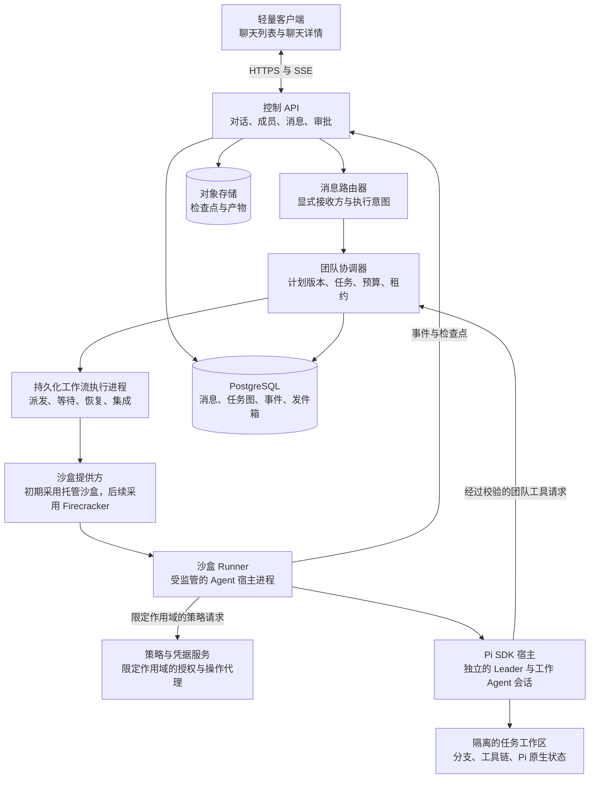

# NexRun 架构设计

状态：目标架构提案；尚待实现

更新日期：2026-11-04

语言：简体中文

[英文版](architecture.md)

NexRun 是一个以聊天为核心、用于操作编程 Agent 的云应用。第一版以 Pi Agent 作为主要且唯一深度集成的 Agent 运行时。用户使用聊天列表和聊天详情页。首轮交付单聊，群聊和受明确限制的 Agent Team 执行留待后续版本。

该架构由轻量客户端、持久化控制面和可随时替换的云沙盒组成。每个 Pi 运行时在执行环境中保留其原生推理循环和上下文。NexRun 负责对话访问、消息路由、团队协调、持久化任务、授权、事件历史和恢复。团队 Leader 也是一个在沙盒内运行的 Pi Agent；控制面协调器是一个确定性服务，并非另一个不受限制的推理循环。

商业依赖准入和语言约定由 [AGENTS.md](../AGENTS.md) 规定。所有软件包版本、传递依赖、镜像、扩展和服务条款均须通过该策略审查后才能采用。

## 当前交付范围

[Sprint 1](sprints/sprint1.zh-CN.md) 定义当前实现承诺：React 与 shadcn/ui 前端、Node.js 服务、持久化单聊、流式输出，以及禁用工具的单个 Pi Agent 集成和确定性模拟适配器。Agent Team 和群聊均后置。本轮不要求可执行工具、云沙盒基础设施、Temporal、Valkey 或对象存储。

下文的群组、团队和沙盒章节描述后续版本的目标架构，不是 Sprint 1 验收条件。纯文本开发使用关闭工具和资源发现的受监管宿主；在启用仓库代码或工具前，先补齐更强的执行隔离边界。

## 目标与范围

初始版本提供由 Pi 支撑、可靠的英文和简体中文单聊产品。后续群组和团队版本加入成员管理、显式指定 Agent，以及预定义的 Leader（统筹者）、Builder（构建者）和 Reviewer（审查者）团队。在后续模型中，单个用户可以创建包含多个 Agent 的群组，其他获授权的人类用户也可以加入。

**群组**是具有成员和访问策略的共享 Conversation。**Agent Team** 是角色与委派配置的版本化定义。**团队 Run** 是针对一个用户目标执行一次该配置。这些是不同的对象：创建群组既不会启动团队，也不会为其授予凭据。如果将来添加侧边栏文件夹和标签，它们属于展示功能，不是安全组。

首个版本不包含 Agent Team、群聊、多 CLI 集成、完整 IDE、可执行工具、自由形式的 Agent 辩论、递归委派、桌面流传输、自动安装技能和模型微调。未来的 Agent 适配器仍是扩展边界，不是 MVP 交付要求。

## 系统边界



### 轻量客户端

浏览器呈现聊天历史、群成员、Agent 身份、执行卡片、审批和可展开的详情。服务端状态具有权威性；本地乐观显示的消息在被持久化受理前标记为待确认。关闭浏览器不会停止已受理的 Run。

使用 SSE 推送经过授权的对话更新。终端 WebSocket、差异、文件、预览和产物属于从聊天中打开的可选详情界面，不是永久显示的顶层面板。浏览器不持有基础设施管理凭据或不受限的数据库访问权限。

### 控制面

采用模块化单体，包含 API 和工作流执行进程。其中，对话模块执行成员权限检查，消息路由器解析接收方，团队协调器校验并持久化提议的计划。协调器通过一个持久化工作流系统进行调度；它不信任 Agent 直接修改任务表。

Leader 通过受控工具提出计划。授权、依赖校验、预算预留、执行状态和取消由平台负责。Leader 不能批准自己的请求，也不能扩大发起用户的权限。

### 执行面

Runner 在沙盒内为每个活跃的 Pi 会话监管一个专用 Node.js Agent 宿主进程。在这些宿主中使用 Pi SDK 配置资源和工具。不要将由仓库控制的扩展导入 API 进程。独立进程有助于隔离生命周期；实际的租户和工作区边界由独立沙盒以及文件系统和网络控制来保障。

Runner 可以上报限定作用域的执行事件，并发起获授权的团队工具请求。这些请求仍属于不可信提议，必须依据当前 Run、执行尝试、角色和计划版本进行校验。

## 产品模型与工作区归属

| 实体 | 职责 |
| --- | --- |
| Organization | 组织；租户边界、成员关系、策略和配额 |
| Project | 项目；可选的仓库连接、环境默认配置和项目访问策略 |
| Conversation | 对话；私聊或群聊，定义通信历史和成员边界 |
| ConversationMember | 对话成员；人类用户或对话内的 Agent 参与者，具有稳定 ID 和限定作用域的权限 |
| Message | 消息；对话中的一条记录，包含作者、显式接收方、回复目标和执行意图 |
| AgentProfile | Agent 配置档案；可复用的配置方案，包含 Pi 模型设置、角色提示、工具策略和资源 |
| AgentInstance | Agent 实例；根据配置档案创建、仅属于某一对话的 Agent 身份 |
| AgentTeamDefinition | Agent 团队定义；包含角色、允许的委派方式和限制的版本化模板 |
| TeamBinding | 团队绑定；分配给某个 Conversation 的团队实例，包含具体的 AgentInstance |
| Run | 运行；持久化的用户目标，模式为 `single` 或 `team`；团队 Run 会保存其 TeamBinding 快照 |
| Task | 任务；Run 内版本化的工作、协调或集成单元，包含依赖、执行方和结果契约 |
| AgentSession | Agent 会话；一个 AgentInstance 及其允许执行作用域对应的 Pi 原生对话与上下文 |
| ExecutionAttempt | 执行尝试；通过租约将一个 Task 派发给 Runner 的一次执行，附带隔离令牌和原生轮次映射 |
| Workspace | 工作区；持久化工作副本和环境，可根据 Project 为 Task 派生 |
| Approval | 审批；人类对某项精确操作作出的限定作用域授权 |
| Checkpoint 和 Artifact | 检查点与产物；可恢复状态，以及保留的版本化输出 |

Conversation 不是 Pi 会话。一个群组可以包含多个独立的 AgentSession，Pi 原生记录也不是共享聊天日志。Run 是平台上的用户目标，不等同于一次原生 Agent 轮次。`TeamRun` 表示 `Run.mode = team`；它不会引入第二套相互竞争的执行记录。

当授权、Agent 身份、Workspace 和上下文作用域均保持不变时，私聊可以在串行 Run 之间复用 AgentSession。团队 Leader 使用限定于 Run 的会话；每个委派给工作 Agent 的 Task 都从独立会话和显式任务包开始。执行尝试只有在核对状态后才能恢复该 Task 的原生会话。绝不在不同 Conversation 之间共享原生会话，也不并发向同一会话提交提示。

AgentProfile 是配置方案，不是全局上下文或凭据容器。在两个群组中实例化同一个配置档案，会创建相互独立的 AgentInstance。为每次 Run 保存团队定义、配置档案、仓库基准版本和策略版本的快照；除非显式修订已获接受，否则修改模板只影响未来的 Run。

开始讨论时，Project 是可选的。需要源文件的执行必须绑定到 Project 和获授权的 Workspace。一个群组可以讨论多个项目，但首个支持仓库的版本将每次 Run 限定为最多一个仓库；它不会静默合并文件系统或凭据作用域。

对 Workspace 的修改需要独占租约，包括终端和辅助工具的写入。并发写入的 Task 使用独立工作副本，通常也使用独立沙盒。Git worktree 共享仓库元数据，不能作为租户边界。Workspace 检查点包含相关的未提交和未跟踪文件，而不仅是仓库 URL 和分支。

## 聊天列表与聊天详情

首个客户端具有两个主要界面。在桌面端，它们可以显示为相邻窗格；在移动端，它们分别作为列表路由和详情路由。

| 界面 | 内容 |
| --- | --- |
| 聊天列表 | 私聊或群聊图标、标题、成员或团队标记、最近一条可见消息、未读数，以及 Run 活跃、等待或失败的状态指示 |
| 聊天顶部 | Conversation 名称、成员管理、绑定的团队、当前 Run、可选的项目和分支，以及限定作用域的控制项 |
| 时间线 | 人类和 Agent 消息、团队计划卡片、Task 状态卡片、审批和输入卡片、最终总结，以及产物引用 |
| 输入区 | 消息、回复和接收方选择器、基于稳定 ID 的提及、附件，以及显式执行操作 |
| 可展开详情 | 任务图、各 Agent 的活动，以及按需打开的差异、文件、终端、用量和应用预览 |

保持主时间线易于阅读：一个用户目标创建一张团队执行卡片，工作 Agent 的活动嵌套在卡片内。将可见结果归属于实际执行的 Agent 角色。通常由 Leader 发布汇总回复；工作 Agent 的结果可以展开查看，不必将每一次工具增量都发送到群组。不要将模型隐藏推理呈现为团队记录。

在服务端保存每个人类成员最后已读的对话序号。未读状态和通知只统计可见事件，不统计每个内部工具事件。缺失的用量数据表示不可用，而不是零。

主要流程为：创建私聊或群组，添加 Agent 成员或绑定团队，在需要时选择仓库，发送指定接收方的请求，跟进执行卡片，批准获授权的操作，并审查集成结果。创建群组或添加团队不会分配永久运行的 VM。

## 群组与消息路由

### 成员关系与权限

一个群组可以包含同一租户中的一个或多个人类用户，以及多个 AgentInstance。Conversation 成员身份授予共享消息的访问权，不会自动授予每个项目或机密的访问权。群聊功能上线后，新加入的人类成员可以访问共享历史；邀请流程必须明确告知这一点。私聊历史和个人 Agent 记忆绝不会被自动导入。

| 权限 | 默认授权对象 |
| --- | --- |
| 读取或发布共享消息 | 活跃且获授权的人类成员 |
| 添加或移除成员，或绑定和编辑团队 | Conversation 所有者或明确获授权的管理员 |
| 启动或引导 Run，或修订其计划 | 有权访问所选项目和凭据的获授权操作人员 |
| 取消 Task 或团队 Run | Run 发起人或获授权的操作人员、管理员 |
| 批准敏感操作 | 当前对该资源具有审批权限的人类审批人 |
| 提议工作或发布限定作用域的结果 | 通过经过校验的平台工具操作的指定 Agent 角色 |

成员角色和项目角色必须同时允许该操作。每个 Run 记录发起的人类用户、授权作用域、凭据来源和费用承担方。Agent 不得继承所有群成员权限的并集，不得仅因个人密钥的所有者加入群组就使用其密钥，也不得代表人类审批。

当成员被移除或权限被降低时，在支持撤销的范围内终止该成员的实时订阅、终端访问和短期链接。暂停权限已被撤销的 Run，使受影响的审批失效，并在进一步派发前重新授权。在新的上下文纪元下重建受影响的 Agent 上下文，不要假定删除聊天消息就能清除模型原生历史，或抹去已经完成的外部副作用。

### 确定性的接收方路由

先持久化 Message。客户端除显示用的提及外，还发送已解析的参与者或团队 ID；服务端校验这些引用，并记录最终路由决定。仅在当前 Conversation 内解析名称标识。回复接收方应在提交前显示，不得根据含糊文本进行不可见的推断。

| 输入 | 默认路由 |
| --- | --- |
| 私聊消息 | 发送给该聊天的 Agent；忙碌时排队，或显式引导当前执行 |
| 未指定执行接收方的普通群消息 | 保存为共享对话；不调用模型 |
| 显式 `@agent` 或选定的回复接收方 | 仅发送给该 Agent，且限制在其配置的权限内 |
| 显式 `@team` 或运行团队操作 | 创建团队 Run，并激活其 Leader |
| 提及多个 Agent | 仅路由至显式选定的 Agent ID，分别作为独立的单 Agent Run；需要协调工作时使用团队接收方 |
| Agent 输出中包含提及 | 仅显示文本；不自动递归激活 |
| 限定作用域的委派或结果命令 | 由协调器校验并推进现有 Run |

群组默认为 `mention_only`。输入区可以保留团队等显式接收方，但必须显示该接收方，确保纯文本正文不会暗中向所有 Agent 广播工作。消息受理和 Run 受理具有不同状态。

### 上下文与可见性

从获授权的材料构建不可变任务包：目标、截至已记录序号的有界对话上下文、仓库和基准提交、文件或产物引用、依赖、验收标准、角色策略，以及计划版本。共享历史是数据，不是平台授权来源。不要将完整群日志当作每个工作 Agent 的原生聊天重放。

Leader 上下文、工作 Agent 上下文、共享时间线和详细执行事件是不同的视图。共享 Conversation 不会覆盖项目访问限制：要么将 Conversation 的可见对象限定为获授权的项目读者，要么不在共享时间线中显示由项目派生的输出和产物链接。群组公开事件使用自己的序号。受限的 Task 事件和原生记录使用独立授权的流；绝不能将它们发送到浏览器后仅通过 UI 隐藏。发布的总结和附件必须遵守来源访问权限和对话可见性要求。

## Agent Team 与任务执行

### 初期团队模型

交付一个可配置的小型模板，包含 Leader、Builder 和 Reviewer。它们均使用 Pi，但可以采用不同的受支持模型、工具、提示和预算。只读规划和审查，与可写构建采用不同策略。角色名称本身不会授予文件系统或网络权限。

Leader 拆解目标并提出 Task。Builder 产出版本化变更。Reviewer 检查实际提交的精确版本并报告发现的问题。协调器负责调度和集成；它绝不将模型关于工作已完成的陈述当作数据库状态转换。Reviewer 获得只读源代码访问权限，并在需要时获得独立且获准用于检查的临时空间。

相互独立的 Task 可以并行运行，初期可配置上限为每个团队 Run 最多同时活跃两个工作 Task。同一角色可以拥有多个分别受限的实例，每个实例具有独立状态。初期团队实现仅允许 Leader 委派；禁止工作 Agent 相互派生、无上限地变更成员，以及递归委派。

### 受控团队工具与任务图

以下名称描述 NexRun 工具，不是 Pi 内置的团队 API：

| 工具 | 角色与作用 |
| --- | --- |
| `team.propose_plan` | Leader 提出版本化无环任务图，包含目标、依赖、负责人和验收标准 |
| `team.delegate` | Leader 请求派发一个已就绪的 Task；协调器检查作用域、依赖和预留预算 |
| `team.get_status` | 获授权的参与者读取限定作用域的持久化执行状态 |
| `team.submit_result` | 工作 Agent 提交总结、结果版本或产物引用，以及验证证据 |
| `team.request_input` | 参与者请求用户作出决定或澄清，不会因此为自己授予权限 |
| `team.publish_summary` | Leader 提出面向用户的汇总结果，由平台发布 |

通过 Pi 宿主中已获准的自定义工具实现这些能力。每个请求携带稳定命令 ID、Run、Task 和执行尝试身份、计划版本，以及授权作用域。Agent 不得写入任务表或在控制宿主上创建子进程。平台校验任务图，执行任务数量和允许接收方限制，并通过事务持久化变更。

将 Task 存储为 DAG，使用显式状态，例如 `blocked`、`ready`、`running`、`waiting_for_approval`、`submitted`、`accepted`、`failed`、`cancelled` 和 `reconciliation_required`。提交的结果不会自动被接受。只有在所需结果及其契约通过策略或获授权审查者的验收后，依赖它们的 Task 才会就绪。

正常流程为：用户目标 -> Leader 计划 -> 经过校验的 DAG -> 就绪的工作 Agent -> 版本化结果 -> 审查 -> 串行集成与验证 -> 最终总结。协调器为 Leader 的初始规划和后续继续执行创建受限的内部 `coordination` Task，并为应用结果创建 `integration` Task。这些 Task 位于 Leader 提出的工作图之外，具有常规的执行尝试身份、租约、取消机制和预算；因此，Leader 在首次提出计划前就已拥有有效的 Task 和执行尝试。Agent 不能创建或重新定义这些归平台所有的 Task。持久化每一次状态转换；Leader 上下文不是调度器的事实来源。委派返回持久化的 Task 引用，而不是阻塞工具调用直至所有工作 Agent 完成。结果被接受后，工作流通过去重通知恢复 Leader；等待中的工作不占用模型轮次或工作 Agent 执行名额。

### 预算与有界协调

派发前预留并发名额和资源预算。Run 预算涵盖 Leader 轮次、工作 Task、重试和集成。初期可配置限制为最多八个工作 Task、八个 Leader 协调轮次、两个并发工作 Agent、禁止递归委派，以及最多两轮由审查驱动的修复；超出限制需要获授权的显式扩展，不能静默循环。

等待依赖的 Task 不获取工作 Agent 执行名额。等待审批或输入时，应区分模型轮次调度名额、仍在运行的沙盒资源和 Workspace 独占租约：只有在宿主已安全让出执行且没有工具仍在运行后，才能释放模型名额。只要进程仍可能写入，就继续进行资源用量核算并保留写入租约；或者先暂停写入、创建检查点并停止该执行，再释放它们。只要原写入方仍可恢复，就绝不允许第二个写入方进入。继续执行前，重新校验权限、租约和预算。如果无法获得可靠的模型用量核算，应将估算值明确标注，并执行派发次数、运行时长、沙盒资源和重试限制；不要根据不完整的提供方统计声称能够实施精确的令牌硬上限。

### 工作区与集成

每个可写 Task 都从明确的基准提交开始，在隔离的工作副本中执行。交接引用不可变提交或产物，以及声明的依赖。Reviewer 挂载或恢复已提交的版本，而不是其他工作 Agent 可以在其审查期间修改的可变分支。

使用一个具有独占写入租约的集成 Workspace。按依赖顺序应用已接受的变更，显式解决冲突，并在其中运行选定的验证。审查结果绑定到版本哈希；实质性变更会使相应审查失效。Task 完成、集成成功，以及获准推送或发布是不同的结果。

如果集成失败，保留已提交的产物，并公布实际阻碍。Leader 可以提出受限的修复 Task；不能通过总结尚未解决的合并冲突就将团队标记为成功。没有仓库时，团队可以通过交付已验收产物完成工作，而不必进行代码合并。

### 执行中引导与取消

为聊天消息、引导 Leader、取消单个 Task 和停止团队 Run 提供独立操作。目标发生实质性变更时，创建新的计划修订。初期团队实现采用保守策略：冻结派发，并替代旧修订中所有未完成的 Task（工作、协调和集成），使其未使用的审批失效，且在替换前核对运行中的执行尝试。只有在显式重新校验契约和授权后，才能引用先前已接受的不可变结果。这一规则使计划版本检查具有明确语义；选择性继续执行中未变化的 Task 属于后续优化。不要静默改写已经派发的契约。

停止团队时，先阻止新派发，再传播取消、撤销未使用的权限、核对运行中的执行尝试，并报告每个 Task 的实际结果。已取消或已被替代的执行尝试返回的迟到结果仅为审计而保留，不能重新激活依赖。取消无法回滚已完成的外部副作用。

## Pi 运行时与未来的 Agent 适配器

### Pi 作为第一版运行时

此处的 Pi 指上游编程 Agent，其代码仓库目前位于 `earendil-works/pi`，原为 `badlogic/pi-mono`。当前主项目许可证为 MIT；软件包发布版本及所有捆绑和传递组件仍须进行精确版本审查。参见 [Pi 源代码](https://github.com/earendil-works/pi)和[许可证](https://github.com/earendil-works/pi/blob/main/LICENSE)。

在受监管的沙盒 Agent 宿主中使用 Pi TypeScript SDK。SDK 提供原生会话和资源集成；平台提供显式工作目录、已获准的资源和持久化会话存储。参见 [Pi SDK](https://github.com/earendil-works/pi/blob/main/packages/coding-agent/docs/sdk.md)。对于承诺支持原生继续执行的 Run，不要使用内存会话管理器。

Pi 文档将子 Agent 行为描述为扩展，而不是内置的团队产品。团队图和调度器由 NexRun 负责。参见 [Pi 编程 Agent 概览](https://github.com/earendil-works/pi/blob/main/packages/coding-agent/README.md)。

### 运行时集成契约

| 平台需求 | 集成设计 |
| --- | --- |
| 流式输出与完成 | 在提交前订阅；映射消息和工具事件，并核对最终状态，不要将提示受理视为执行完成 |
| 持久化上下文 | 将 Pi 原生会话文件和活跃分支引用与共享聊天消息分开保存 |
| 忙碌 Agent 的输入 | 提供显式引导或后续输入行为；绝不并发向同一原生会话提交提示 |
| 受控工具 | 安装已审查的平台工具和执行前检查；保留操作系统和网络层的强制控制 |
| 清理 | 监管取消和资源释放，并记录意外进程丢失 |
| 恢复 | 在原生继续执行前核对命令登记表和副作用 |

Pi 原生会话格式是包含分支条目的 JSONL；不要通过将共享群历史赋给内存消息数组来重建它。参见 [Pi 会话格式](https://github.com/earendil-works/pi/blob/main/packages/coding-agent/docs/session-format.md)。

对于提供文档所述事件生命周期的版本，如果仍有自动工作待执行，`agent_end` 不一定表示最终完成。应使用文档规定的稳定结束状态，并检查失败和中止状态。针对固定的发布版本测试这一行为。参见 [Pi 事件流](https://github.com/earendil-works/pi/blob/main/packages/coding-agent/docs/json.md)。

经过审查的扩展或自定义工具边界可以提供执行前决策，但扩展使用宿主的权限执行。禁用未经审查的发现和软件包安装；不要将扩展钩子视为沙盒。参见 [Pi 扩展](https://github.com/earendil-works/pi/blob/main/packages/coding-agent/docs/extensions.md)。

### RPC 与后续提供方

RPC 是可选的子进程传输方式，不是第二个 MVP 集成项目。如果使用它，严格按 LF 拆分协议记录，关联响应 ID，持续读取 stdout，并将诊断信息保留在 stderr。参见 [Pi RPC](https://github.com/earendil-works/pi/blob/main/packages/coding-agent/docs/rpc.md)。

保留一个小型适配器能力契约，涵盖结构化事件、原生继续执行、执行中引导、中断、可强制执行的工具审批和用量报告。Codex、Claude Code、Gemini CLI 和 PTY 兼容性可以后续添加，无需改变 Conversation 或 Team 身份。不要将这些集成作为以 Pi 为核心的 MVP 的交付前提。

## 命令与事件

为 Conversation、成员关系、Message、团队绑定、Run、Task 和 Approval 使用明确的 API。人工发送的 Message、请求执行的 Run 和 Pi 原生轮次具有不同的标识符与确认状态。

| 通道 | 用途 |
| --- | --- |
| HTTPS 命令 | 管理聊天、发布指定接收者的消息、启动/修订/取消工作，以及决定审批结果 |
| Conversation SSE | 重放已授权的共享消息和经安全处理的执行卡片 |
| Task 事件 SSE | 具有独立游标、经授权的详细执行活动 |
| 可选 WebSocket | 交互式终端输入、输出和尺寸调整 |
| Runner 私有传输通道 | 经过身份验证的派发、心跳、命令响应和事件接收 |
| 可选预览网关 | 对选定沙盒应用端口的授权访问 |

共享会话事件包含：

```json
{
  "schemaVersion": 1,
  "eventId": "evt_example",
  "conversationId": "conv_example",
  "runId": "run_example",
  "taskId": "task_example",
  "agentInstanceId": "agent_example",
  "attemptId": "attempt_example",
  "planVersion": 1,
  "sequence": 42,
  "type": "task.status_changed",
  "occurredAt": "2026-11-04T00:00:00Z",
  "payload": { "status": "running" }
}
```

服务器为共享 Conversation 分配单调递增的序号。客户端按事件 ID 去重，并使用各事件流独立的游标。受限 Task 日志和原生会话不嵌入此共享事件流。将大型输出存为经授权的产物，并批量发送文本增量，同时保留可见的生命周期转换。

限制事件流缓冲区大小，并在断开处理缓慢的消费者时提供可恢复的游标。分别定义消息、详细事件、终端输出和原生会话的保留策略。游标过期时，返回明确的重新同步响应，包含当前可见状态和可用历史；绝不能将缺失事件静默呈现为已重放。

接受命令时使用幂等键和持久化 outbox 记录。为每个 Run/Task/计划修订使用唯一派发键，并使用唯一的有效 attempt 租约。重复回调和团队工具请求不能创建重复 Task 或回复。先持久化已接受的事件，再发送通知；通过重放恢复通知。

根据有效的租户、Conversation、项目、Task 和资源权限，对每条路由和事件流进行授权检查。从身份验证中获取身份，而非信任请求中声称的 ID。只有经授权的发布路径才能将详细 Agent 事件转换为群聊可见消息。

## 持久执行与恢复

Temporal 协调顶层 Run 工作流和限定范围的 Task 执行，包括沙盒分配、工作区挂载、派发、审批等待和清理。团队协调器持久化计划修订和任务状态转换，由唯一的工作流路径负责推进每条已接受的命令。将 token 流和大型输出保留在工作流历史之外；仅在历史中存储引用和生命周期转换。

Temporal Activity 可以重试。在正常工作流重放期间，已完成的 Activity 不会重新执行，但在结果被记录前已完成的操作可能再次运行。因此，每个外部副作用都需要适当的幂等性或结果核对机制。参见 [Temporal Activity 幂等性](https://docs.temporal.io/activity-definition)。

启动 CLI 进程是异步命令，不是恰好执行一次的事务。Runner 维护命令注册表，并确认稳定的 Task-attempt 派发标识符。工作流重试时先检查现有命令或 attempt。不要在超时后盲目重新启动 Agent。

### 状态归属

| 状态 | 权威来源 | 恢复方式 |
| --- | --- | --- |
| Conversation、计划、Task 和事件游标 | PostgreSQL | 数据库恢复和事件重放 |
| 工作流推进 | Temporal | 工作流历史和确定性重放 |
| 原生对话 | Agent 会话文件和原生 ID | Adapter 支持的会话延续 |
| 工作区文件 | 持久存储和检查点清单 | 挂载存储卷或恢复一致的检查点 |
| 进程内存 | 运行中的沙盒或可选 VM 快照 | 支持时恢复；否则重建进程 |
| 外部副作用 | 目标服务与操作台账 | 查询、去重或核对结果 |

PostgreSQL 提供应用状态，Temporal 则拥有工作流执行历史。这些存储之间没有分布式事务。使用 outbox、稳定的命令 ID、幂等处理器和状态核对，使两者的状态视图趋于一致。兼容 Redis 的缓存不能成为第二个事实来源。

### Run 生命周期

团队 Run 聚合其 Task 图。只要仍有必需工作在执行，它就保持运行状态；当进度受阻且没有任何必需 Task 可以运行时，才进入等待状态。只有在所有必需结果和集成检查都被接受后，它才能成功；Leader 进入空闲状态并不意味着团队已经完成。

```text
queued -> provisioning -> running -> succeeded
                            |----> failed
                            |----> waiting_for_approval -> running
                            |----> waiting_for_input -> running
                            |----> cancelling -> cancelled
                            |----> interrupted -> reconciliation_required
```

这些是应用层状态，并不保证每个服务提供方都会发出相应事件。由经过验证的原生完成结果判定成功；仅有进程退出可能并不足够。只有确认前一个 attempt 已无法继续执行后，恢复过程才创建受跟踪的新 attempt。分别恢复已完成的 Task 结果、依赖状态、待处理审批和集成；绝不能因为 Leader 进程丢失就重新运行整个团队。

为每个 attempt 获取执行租约和递增的 fencing token。控制面拒绝过期写入；受控操作代理拒绝过期的执行授权。同时检查 attempt fencing 和计划版本，防止被取代的 Task 接受结果或放行依赖它的 Task。断开连接的 Runner 必须在租约过期时停止新工作。在替换前，撤销其凭据并终止或隔离其沙盒，因为仅靠服务端 fencing 无法阻止旧进程的任意网络流量。

### 恢复保证

| 保证 | 承诺 |
| --- | --- |
| 连接恢复 | 执行持续进行时，浏览器可以重新连接并重建持久化活动 |
| 会话延续 | 受支持的 Agent 可以在进程重建后继续已保存的对话 |
| 环境恢复 | 丢失的沙盒可以从最后一个持久化工作区状态重建 |

不作出任意 CLI 都能在先前进行中的同一次工具调用内部精确恢复的通用保证。如果外部操作可能已经发生，则进入 `reconciliation_required` 并检查其结果，而不是自动重复执行。

## 沙盒生命周期与存储

围绕创建、检查、连接、停止、销毁，以及受支持的暂停/恢复操作定义 Sandbox Provider 接口。资源配置请求使用稳定标识符。资源核对器识别被遗弃的沙盒，并在检查有效租约后将其回收。

从一个托管沙盒提供方开始；E2B 是候选方案，其文档列出了创建、连接、暂停、恢复和终止等生命周期操作。采用之前，评估所选套餐、区域、保留策略、网络控制和商业条款。参见 [E2B 沙盒生命周期](https://e2b.dev/docs/sandbox)。

自行管理的 Firecracker 是后续 Provider。它需要兼容的 Linux 主机、KVM 和对 `/dev/kvm` 的访问权限；不能假定它能在任意托管平台内运行。参见 [Firecracker 前置条件](https://github.com/firecracker-microvm/firecracker/blob/main/docs/getting-started.md)。

### 环境组成

- 版本化基础镜像包含所选工具链、Runner 和已批准的 Agent 二进制文件。
- 持久化项目工作副本存储源文件和未提交工作。
- 独立的 Agent 状态目录存储会话延续所需材料，并具有明确的保留策略。
- 仅在需要时提供限定范围的临时凭据。
- 依赖缓存按租户、运行时版本和锁文件标识隔离。共享的不可变缓存需要完整性检查；不可信任务不能覆盖可信缓存内容。

优先为每个并发修改的 Workspace 使用独立沙盒。同一 VM 内的多个虚拟桌面不会形成独立的租户边界。浏览器配置文件、凭据和可写状态也需要适当隔离。

### 检查点与快照

在明确的安全边界创建工作区检查点。必要时暂停写入方、刷新数据，并在支持的情况下保存原生会话状态；只有引用的对象已持久化后，才发布清单。清单标识 Agent 版本、镜像摘要、原生会话引用和包含的文件。在可行时排除秘密材料，并限制敏感 Agent 状态的保留。

对持久化工作副本保持单一活跃写入方。冷重建恢复最新的完整检查点，并向用户展示任何可能存在的数据缺口。必须根据实际工作负载和存储成本衡量所需检查点间隔和恢复目标。

VM 快照是可选的恢复加速手段，不是业务事务，也不能替代持久文件存储。Firecracker 不保证恢复后保留网络连接，与快照关联的磁盘文件由集成方管理。恢复后重新连接传输通道、刷新凭据并重新建立租约。参见 [Firecracker 快照支持](https://github.com/firecracker-microvm/firecracker/blob/main/docs/snapshotting/snapshot-support.md)。

快照可能在内存或磁盘中包含凭据。对其加密、强制实施租户访问控制、设置过期时间，并避免将已认证的用户状态克隆到多个环境。使用共享预热模板时，重新初始化每个实例的身份和熵。

仅在没有活跃任务或受保护交互时挂起空闲环境。限制预热池大小、存储保留期限和资源总生命周期，防止被遗弃的会话产生无限费用。

## 安全与授权

### 身份与隔离

使用 OIDC 管理平台身份和组织范围内的角色。对每一次 API 调用、事件订阅、产物下载、终端连接和预览请求进行授权检查。将查询限定在租户范围内，并在适当情况下使用数据库行级策略作为纵深防御。为产物链接设置短有效期的签名，避免将暴露的存储键用作授权凭据。

仅在沙盒内执行仓库代码。施加进程、CPU、内存、磁盘和时间限制。将宿主基础设施凭据、控制面数据库凭据和特权管理套接字保留在沙盒之外。限制对元数据端点、私有网络和管理服务的访问。

### 权限配置

| 配置 | 预期范围 |
| --- | --- |
| 只读分析 | 检查源代码并生成分析，不写入工作区，也不产生外部副作用 |
| 工作区开发 | 修改分配的工作副本，并运行获准的构建和测试命令 |
| 受控发布 | 通过受控路径执行明确授权的外部操作 |

只读模式需要实际的文件系统、工具和网络限制；仅在提示词中加入指令并不足够。使用沙盒与 Agent 组合所支持的最强执行约束。如果所选组合无法强制执行某个权限配置，则禁用该配置。

### 审批执行

将每次审批绑定到请求者身份、租户、Conversation、Run、Task、计划版本、attempt、原生请求 ID、规范化操作哈希、范围、过期时间和一次性执行标识。展示具体命令、目标、草稿或拟议变更。在执行时重新验证授权；如果操作发生变化，则要求重新审批。不要将任意聊天文本解释为审批令牌。

对于敏感发布操作，不向任意 shell 进程提供特权凭据，而是通过经过身份验证的代理服务执行操作。强制实施网络和凭据边界，防止第二种工具绕过已批准的路径。仅允许某个主机名，并不能区分对该服务的读取与写入操作。

可选的模型审查器可以协助对请求分类，但不能替代可强制执行的访问控制。外部文档、工具输出和仓库指令都是不可信输入，不能授予平台权限。

### 凭据处理

优先使用短期、最小权限范围的令牌。使用托管密钥加密存储的秘密信息，并避免在提示词、遥测数据和审批文本中包含秘密值。在可行的情况下，由操作代理服务在沙盒外保管凭据并执行已授权请求。

如果凭据被注入进程环境或可读取的文件，应将其视为该执行环境可访问的信息。日志脱敏可减少意外泄露，但不能让 Agent 看不到可读取的凭据。

每个 CLI 和模型服务都需要各自合规的身份验证设计。尤其是，Claude Code 托管受有关未修改二进制文件、原生身份验证、最终用户凭据和直接用量计费的条件约束。不要假定 SDK 许可证允许转售用量或收集 Claude.ai 会话令牌。参见 [Claude Code 法律与合规说明](https://code.claude.com/docs/en/legal-and-compliance)。

### 浏览器与终端界面

以防御性方式渲染 Markdown 和终端输出。过滤不安全链接和控制序列；不要执行 Agent 消息中的任意 HTML。将应用预览与控制台放在不同的源上，使用限定范围的授权，并限制转发端口。将预览内容视为不可信代码。

桌面流式传输和人工浏览器接管属于后续功能，具有独立的授权和浏览器配置文件隔离要求。它们不是 CLI MVP 的前置条件。

## 国际化与开发语言

英语是主要的产品和开发语言。简体中文是第二支持语言。新增语言区域时无需更改协议标识符。

维护覆盖范围相当、技术决策一致的独立英文文档和简体中文文档。不要将两种语言合并到同一文档中，也不要用摘要代替中文版。为两个版本添加相互链接，并在架构决策变化时同步更新。

| 关注点 | 规则 |
| --- | --- |
| UI 语言区域 | 默认使用 `en`，支持 `zh-CN`，并保留用户的明确选择 |
| 翻译资源 | 使用稳定键、相互匹配的资源目录和 ICU 风格的格式化 |
| 面向用户的错误 | 返回稳定代码和参数；在展示层进行本地化 |
| Agent 回复语言 | 配置 Conversation 默认语言，并允许逐个 Agent 明确覆盖，独立于 UI 语言区域 |
| 原始技术内容 | 保留代码、路径、命令和 CLI 错误；另行提供翻译 |
| 开发产物 | 标识符、注释、API、日志、测试、主要文档和 PR 使用英语 |
| 时间与格式化 | 以一致方式存储时间戳，并按用户的语言区域和时区展示 |
| 未来的定时任务 | 显式存储调度时区；不要根据 UI 语言推断时区 |

测试流式 UTF-8 解码、中文输入法、终端宽字符、复数形式和缺失的翻译键。审批含义和授权哈希由底层操作决定，而非其翻译后的标签。

编程语言支持是一项独立能力。为 Node.js/TypeScript、Python、Go 以及后续其他工具链提供版本化环境模板。平台协议保持语言中立。Linux 沙盒并不意味着支持原生 Windows 或 macOS 执行。

## 候选技术栈

| 层级 | 候选技术 | 理由 |
| --- | --- | --- |
| Web 客户端 | React、Vite、TypeScript、shadcn/ui | 具有独立 API 边界的交互式工作区 |
| 国际化 | 支持 ICU 的 i18next | 英文源资源目录和中文翻译 |
| 控制 API | Fastify 和 TypeScript | 具有类型和模式验证的 Node.js 服务 |
| 契约 | JSON Schema、TypeBox、OpenAPI | 版本化传输协议和生成的 API 文档 |
| 应用数据库 | PostgreSQL | 持久化关系状态和事件索引 |
| Agent 运行时 | 受监督宿主中的 Pi TypeScript SDK | 独立会话和经过审查的平台工具 |
| 工作流执行 | Temporal | 持久化生命周期协调和异步等待 |
| 缓存与速率限制 | Valkey | 主项目采用 BSD-3-Clause 许可证的缓存候选技术 |
| 对象存储 | 兼容 S3 的存储 | 工作区检查点、日志和产物 |
| 实时更新 | SSE 和 WebSocket | 将事件重放与终端交互分离 |
| 身份验证 | OIDC | 平台身份和组织集成 |
| 可观测性 | OpenTelemetry 和结构化日志 | 关联平台与执行诊断信息 |

Temporal 是工作流调度器。Valkey 处理临时缓存和速率限制，不作为另一套并行的持久化任务调度器。持久化命令和事件根据需要保留在 PostgreSQL 和工作流历史中。

Valkey 取代此前未指定版本的 Redis 候选方案。Redis 的许可证随版本而异，因此不能将其统一视为宽松许可证。Valkey 自身的模块、客户端、依赖项和镜像仍需单独审查。参见 [Valkey 许可证](https://github.com/valkey-io/valkey/blob/unstable/COPYING) 和 [Redis 各版本许可证](https://redis.io/legal/licenses/)。

## 商业依赖准入

对每个选定的软件包和发布产物应用[仓库依赖政策](../AGENTS.md#commercial-use-and-third-party-dependency-admission)。优先选择宽松许可证的应用依赖，同时履行其许可证和声明要求。Copyleft 不等于禁止商用，但应用库的例外准入需要经过该政策规定的审查。

依赖清单记录精确版本或摘要、来源、许可证证据、选定的许可证分支、使用与分发模式、义务和审查状态。清单应涵盖传递依赖、向打包产物贡献代码的开发工具、下载的二进制文件、字体、图标和复制的代码。

初始化时加入可复现安装和许可证 CI 门禁。未知或不符合政策的变更必须使门禁检查失败。发布时，针对实际交付物生成 SBOM 和第三方声明。对于客户托管镜像，单独审查操作系统和系统组件的分发事项。

将托管服务、CLI 条款、模型访问和商标与代码许可证分别审查。宽松许可证的 SDK 和用户自备密钥，并不能证明具有托管或转售底层服务的权利。自动化扫描提供审查证据，而非全面的法律保证。

## 部署与运维

独立部署 Web 客户端、API 和工作流 worker。在符合预算与部署要求时，优先使用托管 PostgreSQL、持久化对象存储和已落实运维的 Temporal 服务。执行面是一个单独隔离的资源池，通过 Sandbox Provider 访问。

本地开发可以使用本地基础设施和受限的开发 Runner 来运行 API 与 worker。本地 Runner 不能作为承载恶意多租户工作负载的生产隔离边界。Mac 开发环境无需托管 Firecracker；集成测试可以面向托管沙盒或兼容的 Linux 主机。

使用组织、Conversation、项目、Run、Task、AgentInstance 和 attempt 标识关联日志与追踪。记录排队延迟、沙盒分配时间、首事件延迟、执行失败、重连成功率、检查点距今时长、审批等待和资源消耗。将运维遥测与用户内容分开，并实施保留期限和秘密信息过滤。

服务提供方的用量统计可能缺失或仅为估算。分别跟踪平台计算与存储消耗和模型费用，不要将估算呈现为账单。即使无法精确计量模型用量，也要强制执行运行时间、并发数、CPU/内存、磁盘、产物和保留期限配额。

备份应用数据和必需的工作流状态，定义对象保留策略，并测试恢复。在生产发布前定义可衡量的恢复点目标和恢复时间目标。追踪数据保留、检查点保留和账号删除策略必须协调一致，避免已删除内容通过次级存储被无限期保留。

## 仓库布局

```text
nexrun/
├── apps/
│   ├── web/                  # 英语优先的聊天列表和聊天详情
│   ├── api/                  # 控制面 API
│   ├── worker/               # 持久工作流和状态核对
│   └── runner/               # 沙盒进程监督
├── packages/
│   ├── protocol/             # 命令、事件、错误和能力
│   ├── adapters/             # Pi 集成和未来的 Agent Adapter
│   ├── conversations/        # 成员关系、接收者和聊天发布
│   ├── teams/                # 团队定义、计划、任务和协调
│   ├── pi-tools/             # 为 Pi 宿主提供的经审查团队工具和策略工具
│   ├── sandbox/              # Sandbox Provider 集成
│   ├── policy/               # 权限和审批逻辑
│   ├── db/                   # 数据模型和迁移
│   └── i18n/                 # 英文和中文资源
├── docs/
│   ├── architecture.md        # 英文架构文档
│   └── architecture.zh-CN.md  # 简体中文架构文档
└── infra/                    # 本地和云端部署配置
```

此布局描述实现目标。模块之间应共享带类型的契约，避免 Web 客户端直接耦合到 Runner 或服务提供方的内部实现。

## 交付计划与验收标准

### 聊天与 Pi 基础建设

实现 [Sprint 1](sprints/sprint1.zh-CN.md)：TypeScript 工作区、依赖门禁、React/shadcn 聊天界面、Node.js API、PostgreSQL 历史、模拟流式输出和禁用工具的 Pi 宿主。验证发送、停止、刷新和重连行为。完整身份体系与沙盒执行放在后续迭代；首轮预览保持访问受控，不作为公开多租户服务。

### 群聊与受限规模团队

在后续版本中加入同租户的人类/Agent 成员关系、仅在被提及时路由、稳定的接收者 ID、TeamBinding 配置和预定义的 Leader/Builder/Reviewer 团队。实现显式委派、持久化任务依赖、隔离的任务工作区、审查与串行集成、有界并发、权限和取消。

首轮交付以 Pi 为先，且仅支持单 Agent。群组和团队不属于其完成条件。其他 CLI Adapter、通用 PTY 兼容性、自由形式的递归团队、跨租户群聊联邦、桌面流式传输和完整 IDE 仍为后续能力。

以下是目标系统的验收属性。仅适用于对应版本范围；群组和团队功能上线时，相关属性才成为必需条件。Sprint 1 另有更小的验收清单：

1. 关闭浏览器不会停止已接受的工作；重新连接后恢复可见历史，不产生重复消息，也不丢失未读状态。
2. 重复的 Message、Run、委派或结果命令，对每个幂等键只产生一次逻辑效果。
3. 普通群聊消息或 Agent 发出的提及，不会触发所有成员或自主回复循环。
4. 私聊的原生 Pi 上下文绝不被群聊或另一个 AgentInstance 复用。
5. 只有被指定的 Agent 或选定的团队 Leader 收到执行输入；参与者能够区分已保存的消息和已接受的工作。
6. Worker Task 接收已授权的任务包、独立原生上下文，以及不可变的结果/依赖引用。
7. 循环计划、过量 Task、递归委派和耗尽的预算都不能绕过协调器。
8. API、worker 或 Leader 重启后，能够恢复持久化 Task 状态，不重新启动已确认的工作，也不重新运行整个团队。
9. 沙盒替换会恢复检查点覆盖的文件和原生状态，包括覆盖范围内的未提交工作；结果不确定的外部副作用需要核对。
10. 并行写入方使用独立工作副本；集成仅有一个写入方，并审查实际生成的修订版本。
11. 已过期、被重放、属于旧 attempt、计划已变化或操作已变化的审批，不能授权执行。
12. 被拒绝的敏感操作不能通过另一条 shell 路径使用平台持有的凭据绕过限制；Leader 不能自行批准自己的操作。
13. 移除成员或降低权限会撤销访问，并暂停依赖该授权的工作；私有 Task 日志绝不流式发送给未获授权的群聊客户端。
14. 取消团队会阻止新的派发，过期结果不能重新激活依赖它的工作；实际已发生的部分结果仍然可见。
15. 英文和中文 UI、错误、审批、输入法和重连行为保持等效。
16. 解析后的依赖、经审查的 Pi 资源和实际发布镜像满足商业准入及声明要求。

使用 Pi Adapter 契约测试、确定性的路由器/协调器测试、依赖图和修订版本测试、Runner 生命周期测试、租户/群聊边界测试及工作流故障注入。覆盖 Unicode 事件处理、进程丢失、重复回调、失效租约、处理缓慢的消费者、中断的审批和不完整的检查点。

### 后续版本

在 Pi 工作流可靠之后，加入更多团队模板、更丰富的 Task 检查、定时任务/webhook 和其他 CLI Adapter。桌面流式传输、自行管理的 Firecracker 资源池和更广泛的自主编排仍属于后续功能。

外部触发器需要经过身份验证的接入和去重。用户指令享有优先级，但引导/取消仍须具有明确范围和受支持的语义。后台通知保持安静，仅在有意义的完成、失败、需要输入或审批时通知。

## 实施前需要验证的决策

| 决策 | 所需验证 |
| --- | --- |
| 首个沙盒提供方 | 商业条款、目标区域、隔离、网络策略、存储持久性以及暂停/恢复行为 |
| Pi 版本与模型身份验证 | SDK/事件语义、软件包身份、原生状态保留、经审查的扩展、服务提供方条款和允许的凭据 |
| 团队默认配置 | 角色权限、最大 Task 数/并发数、修复循环次数、预算归属方和结果验收策略 |
| 群聊策略 | 成员管理、历史披露、操作者/审批者权限和撤权处理 |
| 存储实现 | 持久卷可移植性或检查点策略、一致性边界和恢复成本 |
| 工作流部署 | 托管还是自行运维 Temporal、运维成本和备份责任 |
| 发布操作 | 后续支持哪些可执行操作，以及由哪些代理路径强制执行；Sprint 1 不包含此类操作 |
| 恢复目标 | 可接受的检查点间隔、恢复延迟、保留期限和实测成本 |
| 分发模式 | 优先采用托管 SaaS；在交付客户托管镜像前重新评估义务 |
