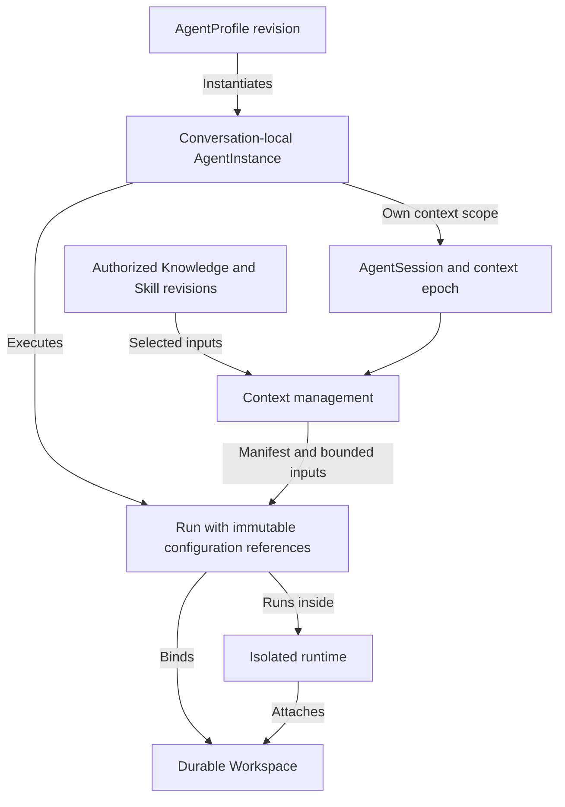

# Sprint 2 Agent and Workspace Foundations

Status: Planned; no Sprint 2 implementation or acceptance is claimed

Created: 2026-11-05

Language: English

[Simplified Chinese version](sprint2.zh-CN.md) · [Sprint 1](sprint1.md) · [Target architecture](../architecture.md) · [Agent administration](../admin-settings.md)

## Sprint goal

Extend the existing direct-chat application into a single-Agent workspace workflow: select a reusable Agent profile, bind a persistent Workspace, explicitly enable knowledge and a declarative skill, and ask Pi to inspect and update a file through restricted tools. Keep Agent identity, native session state, working files, and execution infrastructure independently managed.

Deliver three dependency-ordered milestones: **A — Agent configuration and session boundaries; B — persistent Workspaces and isolated file tools; C — explicit resources and context management**. These are scope and acceptance milestones, not calendar commitments. The complete sprint requires all three; completing only entity tables does not establish working workspace execution.

## Verified starting point

This baseline comes from the current source and Sprint 1 record, reviewed on 2026-11-05. It is not a fresh execution of the test suite or a live provider check.

| Concept | Current implementation | Sprint 2 change |
| --- | --- | --- |
| AgentProfile | One owner-wide runtime/model/language configuration in `admin_settings`; no reusable profile entity | Versioned role, model, capability and resource configuration, separate from provider credentials |
| AgentInstance | One implicit Agent per direct chat; no persistent Agent identity record | One explicit conversation-local identity instantiated from a profile revision |
| AgentSession | `agent_sessions` is keyed by Conversation; Pi native IDs/files are recorded in a private manifest | Explicit Agent, Workspace and context-scope bindings, with multiple historical session epochs |
| Run | Durable acceptance, idempotency, dispatch, cancellation and events already exist | Preserve the Run lifecycle and add immutable execution/configuration references |
| Workspace | Pi creates a conversation-local `workspace` directory | An independently identified, authorized, durable working copy with lifecycle and APIs |
| Runtime | A supervised local Pi child process; no untrusted-code sandbox | One reviewed isolated execution implementation for workspace-enabled Runs |
| Tools and Skills | Explicitly disabled, together with extensions and resource discovery | A small file-tool allowlist and explicitly selected declarative skills |
| Knowledge | Messages and native history; mock `/remember` is a fixture | Versioned, manually maintained facts/preferences/documents with explicit bindings |
| Context management | Native session continuation; SDK compaction is disabled | Authorized resource selection, input limits, scope invalidation and a source manifest |

Source anchors: [initial schema](../../apps/api/migrations/001_initial.sql), [administration schema](../../apps/api/migrations/002_admin_settings.sql), [Adapter contract](../../apps/api/src/agents/types.ts), [Pi host](../../apps/api/src/agents/pi-host.ts), and [settings guide](../admin-settings.md).

Sprint 1's last recorded real Pi acceptance is blocked by OpenAI authentication. Design, migrations and deterministic development can proceed, but Sprint 2 cannot pass final acceptance without valid authorized credentials and a real Pi workspace demonstration. Reading model metadata or passing mock tests does not satisfy that gate.

## Scope and product flow

Retain single-owner direct chats and the existing chat-first UI. A user creates or selects a profile, starts a chat with one AgentInstance, optionally selects a Project/Workspace, chooses knowledge and a skill, sends a task, and inspects tool results and changed files. Pure text chats remain available without allocating a sandbox.

The required workspace demonstration uses explicitly imported, bounded text files and file inspection/editing. A minimal Project organizes source material and access defaults; it does not require a remote repository connection. A Run uses at most one Workspace and, when applicable, one repository. Git clone/push, arbitrary host-directory mounts, shell/build commands and dependency installation are outside this sprint.

Group chats, Agent Teams, membership management, task DAGs, delegation, parallel writers, shared-VM team execution, Firecracker/KVM operations, general terminals, application previews, automatic skill discovery/installation, executable skill scripts, vector databases, automatic fact extraction, autonomous long-term memory, scheduling, full accounts/OIDC and public multi-tenant deployment remain deferred. Temporal, Valkey and S3 are not prerequisites; select only the storage and isolation needed for this slice.

## Model and ownership

| Planned object | Responsibility and boundary |
| --- | --- |
| AgentProfile and revision | Reusable role instructions, permitted model selection, response language, tool policy and resource references; no conversation state or secret values |
| AgentInstance | Stable identity inside one Conversation, pinned to an accepted profile revision; reusing a profile in another chat creates another instance |
| AgentSession | Native context for an AgentInstance and a specific Workspace/resource/authorization scope; native state is stored separately from project files |
| Run | Existing execution record, bound to AgentInstance, Session epoch, optional Workspace and a configuration snapshot |
| Project and Workspace | Optional project metadata and a durable working copy with owner, revision, storage reference and environment specification |
| Execution binding | Run/attempt, sandbox identity, image version, attached Workspace and lease/fencing information; extend existing attempt tracking rather than introduce a team scheduler |
| Knowledge item and revision | Manually authored/imported fact, preference or document, with source, scope, version and active/withdrawn state |
| Skill and revision | Reviewed declarative instructions/reference material with declared tool requirements; no executable extensions or install hooks |
| Context manifest | Authorized references and versions supplied to a Run, selection/omission reasons and input-budget accounting; excludes credentials and hidden reasoning |
| Checkpoint and Artifact | Consistent durable workspace recovery state and retained outputs, each tied to a Run and revision |

No Team, TeamBinding or Task DAG tables are required. A single-Agent Run remains the scheduling unit. All commands and referenced resources are authorized by the server-derived owner; profile names and model-generated tool arguments never grant access.

## Required behavior

### A. Profiles, instances and session boundaries

- Provide profile create/read/edit/archive and profile selection when starting a chat. Each edit creates a revision. Existing instances and accepted Runs keep their pinned revision; applying a new revision to a chat is an explicit idle-time action that starts a new context epoch.
- Keep administration responsible for service defaults and encrypted provider connections. Profiles reference an authorized connection, not copied keys. Resolve runtime/model per accepted Run rather than reading mutable global defaults during generation. Persist non-secret configuration references; credential rotation/revocation follows the existing guarded administration rules.
- Migrate existing chats to explicit legacy instances without fabricating historical profile/resource snapshots. Preserve native session files and manifests and validate their identity before continuation. Missing or incompatible state remains explicitly interrupted; do not silently replay shared messages into a new native session.
- Bind continuation to Conversation, AgentInstance, provider/model, Workspace and resource/authorization scope. Never share native sessions across chats or concurrently prompt one session.
- Changing Workspace, profile/model, enabled knowledge/skill scope, or permissions starts a new context epoch while idle. Stop/reconcile active work first when authority is revoked. Rebuild only from still-authorized material; an old native transcript or summary cannot be copied wholesale into the new epoch. This controls future use and does not claim to erase data already sent to a provider.

### B. Persistent Workspaces and restricted file tools

- Add authorized Project/Workspace create/list/inspect/archive, explicit chat binding, bounded text-file import, and file/diff/artifact views. Workspace storage and environment specifications outlive individual sandbox processes. Do not accept an arbitrary host path as a Workspace.
- Require one reviewed execution implementation with enforced filesystem, network and resource restrictions before enabling workspace tools. Keep infrastructure credentials and management sockets outside it. Failure to provision or enforce the boundary disables workspace execution; never fall back to the existing local text host with tools enabled.
- Provide only bounded file list/read/search/write operations inside the assigned Workspace. Reject traversal, symlink escapes, unauthorized resources and oversized inputs/results. No shell, package installation, repository hooks, executable extensions or unrestricted network tool is included. Declarative skills cannot add tools or authority.
- Use an exclusive Workspace lease for an entire workspace Run, including nominally read-only Runs in this first implementation, plus all user/auxiliary file writes. Another chat can use that Workspace serially with its own Session; concurrent live access returns an explicit busy result. File/diff views during execution may read an explicitly identified immutable revision. Independent Workspaces may still use the existing bounded service concurrency.
- Persist tool operation IDs and outcomes. File writes check an expected revision and publish a new revision atomically. Replaying an acknowledged operation cannot apply it twice. Uncertain write outcomes require reconciliation rather than automatic model/tool retries.
- Fence stale attempts and stop or isolate the old writer before replacing it or releasing its lease. Cancellation remains pending until active tools and the runtime can no longer write. A server-side token alone is insufficient if an old process retains direct writable access.
- Checkpoint safely at declared boundaries, including relevant uncommitted/untracked files. A checkpoint manifest pins the Workspace revision, separately stored native Session reference, context epoch, profile/resource revisions, and image/Adapter versions; publish it only after every referenced object is durable. Restore that consistent pair rather than independently choosing the newest files and Session. If they cannot be paired, interrupt or require an explicit new epoch. Surface any uncheckpointed loss; do not promise exact process or in-flight tool resumption. Retire uncertain Runs as interrupted rather than resubmitting them automatically.
- Record the Session's last consistent Workspace revision at a safe boundary, advancing it for that Session's own confirmed writes. A later Run compares the current revision with that reference. If another chat or user changed it, begin a new context epoch and reread relevant files; do not rely on stale file contents in native history.

### C. Explicit knowledge, skills and context

- Allow users to maintain and explicitly bind scoped project facts/documents and user preferences. Record provenance, revision and withdrawal. Chat history remains a record; it does not automatically become a fact store or system authority. No automatic memory extraction is required.
- Support explicitly enabled, versioned, reviewed declarative skills. Store their source and license evidence, instructions/reference material and required tool subset. Manual activation is sufficient; no marketplace, dynamic discovery or script execution is included.
- Assemble platform/role rules, current task, authorized knowledge/skill references, relevant file material and native session context with explicit source boundaries. Imported documents, chat text and tool output remain data and cannot override platform policy or grant permissions.
- Budget the full effective model input, including native history and tool results, with an output reserve. Record whether accounting is measured or estimated. A cap on newly injected text alone is insufficient. Use bounded selection; if supported limits cannot be satisfied, reject with a localized context-limit error or require an explicit fresh epoch. Do not claim exact token enforcement or automatic compaction without verified Adapter support.
- Record selected versions, scope, source references and omissions in a user-visible context manifest. Show provenance and budget metadata without exposing provider keys, private native transcripts or hidden model reasoning. Correcting or withdrawing a bound resource invalidates its old context scope, including derived summaries.

## Backlog and delivery order

All items below are required for the full Sprint 2 goal. Development may progress in parallel where dependencies permit.

| ID | Milestone | Deliverable | Depends on | Acceptance |
| --- | --- | --- | --- | --- |
| S2-01 | A | Shared contracts and additive Profile/Instance/Session/Run migrations | Sprint 1 baseline | Legacy history remains readable; native bindings are preserved and migration does not fabricate context |
| S2-02 | A | Versioned profiles, explicit instances, settings integration and bilingual UI | S2-01 | Two chats reuse one profile with separate identities/context; edits do not mutate active Runs |
| S2-03 | A | Run snapshots and context-epoch lifecycle | S2-01, S2-02 | Model/resource/Workspace changes cannot reuse an incompatible or revoked native context |
| S2-04 | B | Minimal Project/Workspace APIs, durable storage and import/file views | S2-01 | Authorized files survive service restart independently of chat/runtime directories |
| S2-05 | B | One reviewed sandbox implementation, execution bindings, leases and fencing | S2-04 | Real isolation, busy handling, cancellation and replacement-writer exclusion are verified |
| S2-06 | B | Restricted file tools, operation ledger, revisions, checkpoints and restore | S2-03, S2-05 | Real Pi can read/edit a file; duplicate writes, escapes and lost-runtime recovery are checked |
| S2-07 | C | Versioned manual knowledge and declarative skill binding | S2-02, S2-03 | Sources are inspectable; withdrawn resources and unauthorized tool requirements are rejected |
| S2-08 | C | Context selection, full-input limits and source manifests | S2-06, S2-07 | Selection is bounded and attributable; invalidated content and old summaries do not cross epochs |
| S2-09 | A–C | Regression, live acceptance, documentation and artifact/license review | S2-01–S2-08 | All required evidence below is recorded; mocks are distinguished from real provider/isolation checks |

## Acceptance and release evidence

1. Start two chats from the same profile. Verify independent Agent identities and native Sessions, while profile revisions and the UI/Agent response languages behave as configured.
2. Bind a Workspace and explicit knowledge/skill revisions. Ask real Pi to inspect an imported text file and make a bounded edit using only the allowed file tools. Inspect the actual diff, operation result and context manifest.
3. Try the same Workspace from another chat while it is busy; reject access explicitly. After the first Run finishes, allow serial use with a separate Session. A changed Workspace revision invalidates stale context.
4. Restart the service and replace a sandbox. Preserve chat history, restore the checkpoint's matching Workspace revision and native Session, reconcile the old writer and continue only through a verified compatible Session or an explicit new epoch.
5. Correct/withdraw a knowledge item and tighten tool permissions. Confirm subsequent input excludes old native context and derived summaries; pending/revoked work cannot continue under stale authority.
6. Verify traversal/symlink denial, resource limits, full-input overflow, duplicate operation handling, uncertain writes, cancellation and stale-attempt fencing at the actual enforcement boundary.
7. Run appropriate existing typecheck/lint/build, license checks and chat/settings/API/browser regressions, plus focused new migration, context and workspace tests. Preserve refresh, SSE replay, idempotency, partial-output and legacy text-chat behavior.
8. Record the real Pi result and real sandbox isolation/restore evidence separately from deterministic mocks. If credentials or an admitted execution provider are unavailable, mark the corresponding milestone and final acceptance blocked; do not report the sprint complete.

Review every new or upgraded package, transitive/native component, image, downloaded binary, skill asset and hosted-service term under [AGENTS.md](../../AGENTS.md). Pin selected image digests, update exact-release evidence and inventory, and regenerate release-specific SBOM/notices for actual deliverables. Existing npm checks do not establish system-image or hosted-service rights. This plan selects no new dependency, image or provider and introduces no new license gate implementation.

## Completion boundary

Sprint 2 is complete when a single configured Agent can use explicit, attributable resources to inspect and update a durable Workspace inside an enforced execution boundary, with independent identity/session/file lifecycles and verified recovery. Team coordination and the infrastructure used to host future teams remain separate follow-up work.
