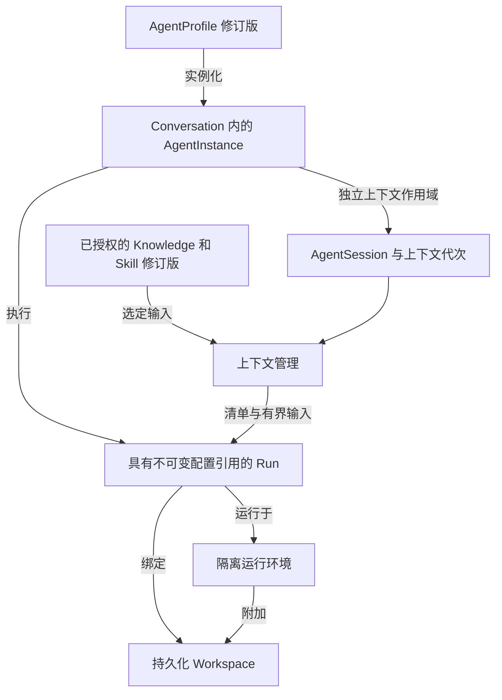

# Sprint 2 Agent 与 Workspace 基础

状态：计划中；不声称已完成任何 Sprint 2 实现或验收

创建日期：2026-11-05

语言：简体中文

[English version](sprint2.md) · [Sprint 1](sprint1.zh-CN.md) · [目标架构](../architecture.zh-CN.md) · [Agent 管理](../admin-settings.zh-CN.md)

## Sprint 目标

将现有单聊应用扩展为单 Agent 的工作区流程：选择可复用的 Agent 配置，绑定持久化 Workspace，显式启用知识和声明式技能，并让 Pi 通过受限工具检查和修改文件。分别管理 Agent 身份、原生会话状态、工作文件和执行基础设施。

按依赖顺序交付三个里程碑：**A — Agent 配置与会话边界；B — 持久化 Workspace 与隔离文件工具；C — 显式资源与上下文管理**。这些里程碑定义范围和验收要求，不构成日程承诺。完整 Sprint 必须完成三者；仅完成实体表不能证明工作区执行流程可用。

## 已核实的起点

以下基线来自当前源码和 Sprint 1 记录，于 2026-11-05 审阅。它不代表重新执行了测试套件或真实服务商检查。

| 概念 | 当前实现 | Sprint 2 变更 |
| --- | --- | --- |
| AgentProfile | `admin_settings` 中只有一份所有者范围的运行时、模型和语言配置；没有可复用的配置实体 | 提供版本化的角色、模型、能力和资源配置，与服务商凭据分离 |
| AgentInstance | 每个单聊只有一个隐式 Agent；没有持久化的 Agent 身份记录 | 从配置修订版实例化一个显式的、限定于当前 Conversation 的身份 |
| AgentSession | `agent_sessions` 以 Conversation 为键；Pi 原生 ID 和文件记录在私有清单中 | 显式绑定 Agent、Workspace 和上下文作用域，支持多个历史会话代次 |
| Run | 已有持久化接收、幂等、分发、取消和事件机制 | 保留 Run 生命周期，增加不可变的执行和配置引用 |
| Workspace | Pi 创建限定于当前 Conversation 的 `workspace` 目录 | 提供具有独立标识、授权、持久性、生命周期和 API 的工作副本 |
| Runtime | 受监管的本机 Pi 子进程；没有用于不可信代码的沙箱 | 为启用工作区的 Run 提供一种经过审查的隔离执行实现 |
| Tools 和 Skills | 与扩展和资源发现一起被显式禁用 | 提供小范围文件工具白名单和显式选择的声明式技能 |
| Knowledge | 只有消息和原生历史；mock `/remember` 是测试样例 | 提供版本化、人工维护并显式绑定的事实、偏好和文档 |
| 上下文管理 | 延续原生会话；SDK 压缩已关闭 | 提供经过授权的资源选择、输入限制、作用域失效和来源清单 |

源码依据：[初始数据结构](../../apps/api/migrations/001_initial.sql)、[管理配置数据结构](../../apps/api/migrations/002_admin_settings.sql)、[Adapter 契约](../../apps/api/src/agents/types.ts)、[Pi host](../../apps/api/src/agents/pi-host.ts) 和[设置指南](../admin-settings.zh-CN.md)。

Sprint 1 最后记录的真实 Pi 验收被 OpenAI 身份验证阻塞。设计、迁移和确定性开发可以继续，但没有有效且经过授权的凭据，以及真实 Pi 工作区演示，Sprint 2 就不能通过最终验收。读取模型元数据或通过 mock 测试不能满足这一门槛。

## 范围与产品流程

保留单所有者单聊和现有以聊天为中心的 UI。用户创建或选择配置，开启包含一个 AgentInstance 的聊天，按需选择 Project/Workspace，选择知识和技能，发送任务，然后查看工具结果和文件变更。纯文本聊天仍然可用，无需分配沙箱。

必需的工作区演示采用显式导入且大小受限的文本文件，展示文件检查和编辑。最小 Project 用于组织源材料和默认访问设置，不要求连接远程仓库。一个 Run 最多使用一个 Workspace，并在适用时使用一个仓库。Git clone/push、任意宿主机目录挂载、shell/build 命令和依赖安装不在本 Sprint 范围内。

群聊、Agent Teams、成员管理、任务 DAG、委派、并行写入者、共享 VM 的团队执行、Firecracker/KVM 运维、通用终端、应用预览、自动技能发现或安装、可执行技能脚本、向量数据库、自动事实提取、自主长期记忆、调度、完整账户/OIDC 和公开多租户部署继续延后。Temporal、Valkey 和 S3 不是前置条件；只选择本次功能切片所需的存储和隔离方案。

## 模型与归属

| 计划对象 | 职责与边界 |
| --- | --- |
| AgentProfile 及其修订版 | 可复用的角色指令、允许的模型选择、回复语言、工具策略和资源引用；不包含会话状态或秘密值 |
| AgentInstance | 一个 Conversation 内的稳定身份，固定使用已接受的配置修订版；在另一聊天中复用该配置时创建另一个实例 |
| AgentSession | AgentInstance 在特定 Workspace、资源和授权作用域下的原生上下文；原生状态与项目文件分开存储 |
| Run | 现有执行记录，绑定 AgentInstance、Session 代次、可选 Workspace 和配置快照 |
| Project 和 Workspace | 可选的项目元数据，以及带有所有者、修订版、存储引用和环境规格的持久化工作副本 |
| 执行绑定 | Run/attempt、沙箱身份、镜像版本、所附加的 Workspace，以及租约和隔离令牌信息；扩展现有 attempt 跟踪，不引入团队调度器 |
| 知识条目及其修订版 | 人工编写或导入的事实、偏好或文档，带有来源、作用域、版本，以及启用或撤回状态 |
| Skill 及其修订版 | 经过审查的声明式指令和参考材料，声明所需工具；不包含可执行扩展或安装钩子 |
| 上下文清单 | 提供给 Run 的已授权引用和版本、选择或省略原因，以及输入预算核算；不包含凭据或隐藏推理 |
| Checkpoint 和 Artifact | 一致、持久化的工作区恢复状态和保留的输出，分别关联 Run 和修订版 |

无需 Team、TeamBinding 或 Task DAG 表。单 Agent Run 仍是调度单元。所有命令和引用资源均以服务端确定的所有者进行授权；配置名称和模型生成的工具参数永远不能授予访问权限。

## 必需行为

### A. 配置、实例与会话边界

- 提供配置创建、读取、编辑和归档，以及开启聊天时的配置选择。每次编辑生成一个修订版。现有实例和已接受的 Run 保留其固定修订版；将新修订版应用到聊天必须是空闲时的显式操作，并开启新的上下文代次。
- 管理设置继续负责服务默认值和加密的服务商连接。配置引用经过授权的连接，不复制密钥。按已接受的 Run 解析运行时和模型，不能在生成过程中读取可变的全局默认值。持久化非秘密配置引用；凭据轮换和撤销遵循现有受控管理规则。
- 将现有聊天迁移到显式的旧版实例，不编造历史配置或资源快照。保留原生会话文件和清单，并在延续前验证其身份。缺失或不兼容的状态必须明确标为中断；不能默默将共享消息重放到新的原生会话中。
- 将延续条件绑定到 Conversation、AgentInstance、provider/model、Workspace，以及资源和授权作用域。绝不跨聊天共享原生会话，也不并发向同一个会话发送提示。
- 更改 Workspace、配置/模型、启用的知识/技能作用域或权限时，在空闲状态开启新的上下文代次。权限被撤销时，先停止并核对活跃工作。仅从仍获授权的材料重建；不能将旧原生记录或摘要整体复制到新代次。这控制后续使用，不声称能够擦除已经发送给服务商的数据。

### B. 持久化 Workspace 与受限文件工具

- 增加经过授权的 Project/Workspace 创建、列表、检查和归档，显式聊天绑定，有界文本文件导入，以及文件、差异和产物视图。Workspace 存储和环境规格的生命周期长于单个沙箱进程。不能将任意宿主机路径直接接纳为 Workspace。
- 启用工作区工具前，必须具备一种经过审查、强制实施文件系统、网络和资源限制的执行实现。基础设施凭据和管理套接字必须位于其外部。无法配置或强制实施该边界时，禁用工作区执行；绝不回退为在现有本机文本 host 上启用工具。
- 只在所分配的 Workspace 内提供有界的文件列表、读取、搜索和写入操作。拒绝路径穿越、符号链接逃逸、未授权资源，以及超大输入或结果。不包含 shell、包安装、仓库钩子、可执行扩展或无限制网络工具。声明式技能不能增加工具或权限。
- 在整个工作区 Run 期间持有排他的 Workspace 租约；首版中名义上只读的 Run 也包含在内，所有用户或辅助文件写入同样受其约束。其他聊天可以通过自己的 Session 串行使用该 Workspace；并发访问实时工作副本时返回明确的忙碌结果。执行期间的文件/差异视图可以读取明确标识的不可变修订版。独立 Workspace 仍可使用现有有界服务并发能力。
- 持久化工具操作 ID 和结果。文件写入检查预期修订版，并原子发布新修订版。重放已确认的操作不能再次应用变更。写入结果不确定时必须先核对状态，不能自动重试模型或工具调用。
- 隔离失效的 attempt，在替换旧写入者或释放租约前，先停止或隔离旧写入者。取消保持待完成状态，直到活跃工具和运行环境不再能够写入。如果旧进程仍直接持有可写访问权限，仅靠服务端令牌并不足够。
- 在声明的边界安全创建检查点，包括相关的未提交和未跟踪文件。检查点清单固定 Workspace 修订版、单独存储的原生 Session 引用、上下文代次、配置/资源修订版及镜像/Adapter 版本；只有全部引用对象已持久化后才能发布。恢复这组一致状态，不能分别挑选最新文件和 Session。无法配对时标记中断，或要求显式开启新代次。明确显示任何未纳入检查点的数据损失；不承诺精确恢复进程或正在进行的工具调用。将结果不确定的 Run 终结为 interrupted，不能自动重新提交。
- 在安全边界记录 Session 最后保持一致的 Workspace 修订版；该 Session 自身已确认的写入可以推进此版本。后续 Run 将当前修订版与这一引用比较。如果另一聊天或用户已修改 Workspace，开启新的上下文代次并重新读取相关文件；不能依赖原生历史中的过期文件内容。

### C. 显式知识、技能与上下文

- 允许用户维护并显式绑定具有作用域的项目事实/文档和用户偏好。记录来源、修订版和撤回。聊天历史仍是记录，不会自动成为事实存储或系统级权威。不要求自动提取记忆。
- 支持显式启用、版本化并经过审查的声明式技能。存储其来源和许可证据、指令/参考材料，以及所需工具子集。手动激活即可；不包含市场、动态发现或脚本执行。
- 以明确的来源边界组装平台/角色规则、当前任务、已授权知识/技能引用、相关文件材料和原生会话上下文。导入文档、聊天文本和工具输出仍是数据，不能覆盖平台策略或授予权限。
- 为完整的有效模型输入制定预算，包括原生历史和工具结果，并预留输出额度。记录核算结果是实测还是估算。只限制新注入文本并不足够。采用有界选择；如果无法满足受支持的限制，返回本地化的上下文超限错误，或要求显式开启新代次。没有经过验证的 Adapter 支持时，不声称实施了精确 token 限制或自动压缩。
- 在用户可见的上下文清单中记录所选版本、作用域、来源引用和省略项。展示来源与预算元数据，不暴露服务商密钥、私有原生会话记录或隐藏的模型推理。更正或撤回已绑定资源时，其旧上下文作用域失效，包括派生摘要。

## 待办与交付顺序

以下所有事项都是完整 Sprint 2 目标的必需部分。在依赖允许时，开发可以并行推进。

| ID | 里程碑 | 交付内容 | 依赖 | 验收 |
| --- | --- | --- | --- | --- |
| S2-01 | A | 共享契约，以及 Profile/Instance/Session/Run 的增量迁移 | Sprint 1 基线 | 旧版历史仍可读取；保留原生绑定，迁移不编造上下文 |
| S2-02 | A | 版本化配置、显式实例、设置集成和双语 UI | S2-01 | 两个聊天复用同一配置，但具有独立身份和上下文；编辑不改变活跃 Run |
| S2-03 | A | Run 快照与上下文代次生命周期 | S2-01, S2-02 | 模型、资源或 Workspace 变更不能复用不兼容或已撤销授权的原生上下文 |
| S2-04 | B | 最小 Project/Workspace API、持久化存储，以及导入和文件视图 | S2-01 | 已授权文件在服务重启后仍存在，独立于聊天和运行时目录 |
| S2-05 | B | 一种经过审查的沙箱实现、执行绑定、租约和失效写入者隔离 | S2-04 | 验证真实隔离、忙碌处理、取消，以及替换时排除旧写入者 |
| S2-06 | B | 受限文件工具、操作台账、修订版、检查点和恢复 | S2-03, S2-05 | 真实 Pi 能读取和编辑文件；检查重复写入、逃逸，以及运行环境丢失后的恢复 |
| S2-07 | C | 版本化人工知识与声明式技能绑定 | S2-02, S2-03 | 来源可检查；拒绝已撤回资源和未授权的工具要求 |
| S2-08 | C | 上下文选择、完整输入限制和来源清单 | S2-06, S2-07 | 选择有界且可归因；已失效内容和旧摘要不能跨越代次 |
| S2-09 | A–C | 回归、真实验收、文档，以及产物和许可审查 | S2-01–S2-08 | 记录以下全部必需证据；区分 mock 与真实服务商和隔离检查 |

## 验收与发布证据

1. 从同一配置开启两个聊天。验证 Agent 身份和原生 Session 相互独立，配置修订版，以及 UI 和 Agent 回复语言按配置生效。
2. 绑定 Workspace 和显式知识/技能修订版。让真实 Pi 仅通过允许的文件工具检查导入的文本文件并进行有界修改。检查实际差异、操作结果和上下文清单。
3. 在 Workspace 忙碌时从另一聊天尝试访问，明确拒绝。第一个 Run 完成后，允许使用独立 Session 串行访问。Workspace 修订版变化时使过期上下文失效。
4. 重启服务并替换沙箱。保留聊天历史，恢复检查点中相互匹配的 Workspace 修订版和原生 Session，核对旧写入者状态，并仅通过经过验证兼容的 Session 或显式新代次继续。
5. 更正或撤回知识条目，并收紧工具权限。确认后续输入不包含旧原生上下文和派生摘要；待处理或已撤销授权的工作不能继续使用过期权限执行。
6. 在实际强制执行边界验证路径穿越和符号链接拒绝、资源限制、完整输入超限、重复操作处理、不确定写入、取消，以及失效 attempt 的隔离。
7. 运行适用的现有 typecheck/lint/build、许可检查，以及聊天、设置、API 和浏览器回归，另加有针对性的迁移、上下文和工作区测试。保留刷新、SSE 重放、幂等、部分输出和旧版纯文本聊天行为。
8. 将真实 Pi 结果、真实沙箱隔离和恢复证据与确定性 mock 分开记录。如果凭据或获准采用的执行服务商不可用，将相应里程碑和最终验收标为阻塞；不能报告 Sprint 已完成。

依据 [AGENTS.md](../../AGENTS.md) 审查每个新增或升级的包、传递/原生组件、镜像、下载的二进制文件、技能资产和托管服务条款。固定所选镜像摘要，更新精确发行版本的证据和清单，并针对实际交付物重新生成发布专属 SBOM 和第三方声明。现有 npm 检查不能证明系统镜像或托管服务的使用权。本计划不选择新的依赖、镜像或服务商，也不新增许可门禁实现。

## 完成边界

当一个已配置 Agent 能在强制实施的执行边界内，使用显式且可追溯的资源检查和修改持久化 Workspace，同时具备独立的身份、会话和文件生命周期，并完成恢复验证时，Sprint 2 才算完成。团队协作以及未来承载团队的基础设施仍是独立的后续工作。
